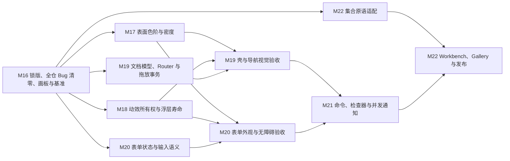

# mygo-md3e 演进路线图（Phase 3 Roadmap：M16 – M22）

> **当前阶段定位（Phase 3）**：Phase 1（M1–M8）建成了纯 Go MD3E 基础规范与控件库；Phase 2（M9–M15，已全部完成并归档于文末）补齐了密度系统、图表、媒体、文档、虚拟表格与零分配治理。
>
> **Phase 3（M16 – M22）的核心使命**：**先冻结窗口、文档、浮层三种状态所有权，再重塑无框桌面 MD3E 皮肤与统一动效编排**，将 `mygo-md3e` 升级为 **“视觉审美直追顶级桌面客户端、动效细腻可控、完整撑起多页面/多文档桌面应用交互架构的生产级框架”**，并紧跟最新上游 `github.com/egoist/mygo` 与 Zero-Bloat DCE 纪律。
>
> **权威架构依据**：全部 10 条核心架构裁决（ADR-01 ~ ADR-10）、候选上游核验、数值级色彩/动效精校、五大骨架 Go-First API 蓝图与 15 项 P1/P2 隐蔽 Bug 清单均沉淀于 [phase3-architecture-review.md](phase3-architecture-review.md)，本路线图与该评审报告保持 1:1 同步。

---

## 1. Phase 3 核心工程原则（ADR-01 ~ ADR-10 精要）

1. **状态所有权先行（ADR-01 ~ ADR-05）**：
   - **单一外壳布局内核**：`AppShell` 与 `AdaptiveScaffold` 共享同一私有布局核心，`WindowTitleBar` 独占系统按钮安全区与拖窗；
   - **稳定字符串身份**：`NavigationSidebar` / `NavigationRail` / 底部 `NavigationBar` 投影同一份 `NavGroup`/`NavItem` 数据，业务状态、收起偏好与当前路径解耦；
   - **历史与文档所有权清晰**：单页应用用一个 `*ui.Router`，需每文档独立 `Back()` 的多文档工作区每个 Tab 持有一个 `*ui.Router`；文档模型持久持有草稿、编辑缓冲、`ScrollState`/`ListState`、选区与焦点槽（跨越上游 10 页视图缓存上限），`TabStrip` 仅派发文档意图；
   - **单一关闭裁判**：轻浮层逻辑关闭立即释放输入，重模态根遮罩独占模态与关闭，父层退出同帧清理子浮层。
2. **上游 `mygo` 可重放锁版（ADR-10）**：
   - M16 第一步将根模块与 `examples/m2-demo` 共同升级至经核验的上游候选提交（如 `611bbf74402f`，原生提供 `SplitSecond`/`SplitLimits`/`SplitGap`、`Truncated()`、`Accordion` 禁用头跳过、Router `%2F` 保留等能力），**单独提交升级**并跑通旧消费者兼容夹具与性能基线，严禁无记录飘移。
3. **无框 Tonal 皮肤与单一时钟动效（ADR-06 ~ ADR-07）**：
   - 保持公开 Go API 兼容，升级默认无框 Tonal 表面层次并新增 `tokens.SurfaceStyle`（`SurfaceNeutral` 低色度干净表面），对不透明合成 sRGB 执行完整对比度矩阵门禁；
   - **每个自由度仅受一个时钟控制**（L1 `paintRamp` / L2 锚定 `ElementTransition` / L3 `presence` 模态宿 / L4 `Collapse` 与 `CollapsibleBase` 单通道 / L5 `RouterView` 独占过场），杜绝双重驱动与退场过冲。
4. **根包按需链接与输入语义复用（ADR-08 ~ ADR-09）**：
   - 仅依赖 `github.com/egoist/mygo/ui` 主包的新桌面骨架与表单组件统一落地根包 `md3e`，严禁包级 `init()` 与全局注册表；`dce_test.go` 最小 `Button` 的 `nm` 禁表须同步纳入新增壳、选择器、Toast、RouterView 与 TabStrip。

---

## 2. 完整桌面应用 6 域交互骨架与上游对齐矩阵

| 骨架域 | 解决的核心桌面问题 | 规划组件（根包 `md3e`） | 上游 `mygo/ui` 对齐原语 | 落地波次 |
| :--- | :--- | :--- | :--- | :---: |
| **A. 外壳与可收起侧栏** | 一体化窗口框架、极简折叠导航、溢出工具栏、底栏感知 | `AppShell`（与 `AdaptiveScaffold` 共享内核）、`WindowTitleBar`、`NavigationRail`（56–64dp 纯图标态 + 折叠钮 + Footer）、`NavigationSidebar`、`ActionToolbar`、`StatusBar` | `ui.Sidebar`/`TreeBase`、`ui.Toolbar`、`c.TitleBar()`、`c.SetZoom`、`c.Vibrancy` | **第一波 (M19)** |
| **B. 路由流转与多 Tab** | 多页面历史保活、共享元素飞跃、多文档并发编辑 | `RouterView`、`HistoryButtons`、`Link`、`TabStrip`（新建/关闭/中键/脏点/Pinned/溢出下拉/右键/拖拽重排/`OnDetach` 拖出事务） | `ui.Router`、`BackButton`/`ForwardButton`、`ui.Link`、`ui.TabsBase`、`ui.Drag`/`DragMissed`、`MatchKey` | **第一波 (M19)** |
| **C. 命令中枢与辅助浮层** | 键盘优先全局跳转、非阻塞检查器、通用气泡、页内查找替换 | `CommandPalette`（`Cmd/Ctrl+K`）、`Kbd`、`SideSheet`（Standard 内联可调宽 + Modal 自动降级）、`Popover`、`FindBar`（`Cmd/Ctrl+F`） | `ui.PopoverBase`、`ui.FindBar`、`ui.Split`+`SplitSecond`/`SplitLimits`、`ui.DialogBase`、`AttachedOrigin`/`Flip` | **第二波 (M21)** *(关闭规则与 Kbd 契约在 M18/M19 前置复用)* |
| **D. 表单与高频输入** | 设置页、配置弹窗、过滤搜索、多标签与专业数值录入 | `SearchField`/`SearchBar`（编辑/清除共用内核）、`Select[T]`、`Combobox`、`Autocomplete`、`TokenField`、`Collapsible`/`Accordion`、`Form`/`FormField`/`SettingsGroup`；`NumberInput`/`Stepper`、`EditableText`、`ColorWell`/`ColorPicker` | `ui.SearchField`、`ui.SelectBase`/`SelectBaseOpen`、`ui.ComboboxBase`、`ui.Autocomplete`、`ui.TokenField`、`ui.CollapsibleBase`/`AccordionBase`、`ui.Form`/`Field`/`Fieldset`、`ui.NumberInput`/`EditableText`/`ColorPicker` | **第一波 (M20) + 第三波 (M22)** |
| **E. 并发通知与确认弹窗** | 多通知角落堆叠、Undo 撤销、二次确认/输入弹窗 | `ToastStack` + `PostSnackbar` 适配器（保留 `SnackbarHost` FIFO 兼容）、`ConfirmDialog`、`PromptDialog` | `ui.ToastViewportBase`/`ui.ToastBase`（并发最多 3 条）、`ui.DialogBase` | **第二波 (M21)** |
| **F. 集合视图与拖拽操纵** | 万级卡片网格、泛型树形大纲表、进程内与系统文件拖放 | `GridView`、`OutlineTable[K]`、`DropZone`（拆分为类型化 `ui.Drop[T]` 与系统 `Element.DroppedFiles()`） | `ui.GridView`、`ui.OutlineTable`、`ui.Drag`/`Drop`/`DroppedFiles`/`ListState.Reorder` | **第三波 (M22)** |

---

## 3. 并行交付拓扑（依赖 DAG）

---

## 4. Phase 3 分阶段里程碑规划（M16 – M22）

遵循 [RULE.md](../RULE.md) 的**单主题小步提交（One Concern, One Commit）**与全套预提交门禁。

---

### P0：锁版排雷、美学重塑与动效重构（治本提质）

#### M16 — 上游 `mygo` 锁版同步、基线建立与桌面缺陷清零
> **目标**：先锁定上游可重放提交、补齐画板/关键帧/性能基准，并一次性修复图 3 及审阅发现的全部 P1/P2 桌面缺陷（改视觉之前先让地基干净无毒）。

- [ ] **M16.1 上游 `github.com/egoist/mygo` 可重放锁版（独立提交）**
  - 将根 `go.mod` 与 `examples/m2-demo/go.mod` 升级锁定至最新已核验上游提交（候选 `611bbf74402f` 或更新稳定提交），补齐旧消费者编译夹具（校验既有公开签名与复合字面量兼容）；
  - 复测候选新能力（`SplitSecond`/`SplitLimits`/`SplitGap`、`Truncated()`、`Accordion` 跳过禁用头、`Router` 保留 `%2F` 路径段）并同步记录到 `docs/architecture.md`；
  - 建立可重跑的基准基线任务（记录升级前后 `BenchmarkDashboardSteady`、`BenchmarkDataTable100K/{Steady,Scroll}`、`TestRetainedHeap` 与 `TestButtonDeadCodeElimination` 数值，并建立复用 Monitor 切片夹具）。
- [ ] **M16.2 已知显性 Bug 与全仓 P1/P2 缺陷清零（先红后绿回归单测）**
  - **已知 P0/P1**：
    - [textfield.go](../textfield.go#L321)：`!floated` 时每帧显式调用 `input.Placeholder("")` 清空持久化 `editor.placeholder` + 浮动期按 `labelT` 渐隐；无 `Label` 的 `Outlined` 移除顶部 `10 DIP` 预留；单行 `Filled` 保持固定父链防切 `Label` 丢选区/焦点/撤销（`textfield.go:286`）；
    - [treeview.go](../treeview.go#L486)：改用 `reflect.Value.Comparable()` 修复含切片结构体 key 运行时 panic；明确同名叶跨分支选择契约；
    - [datatable.go](../datatable.go#L566) & [virtuallist.go](../virtuallist.go#L227) & [examples/workbench/monitor.go](../examples/workbench/monitor.go#L534)：修复外部 `ListState` 临时覆盖（菜单/ItemKey/选区/CellsStyle 换肤）不撤回问题，并将 `CellMenu` 复制动作改为捕获 `c.Services()` 而非短寿命 `*ui.Context`；
    - [dialog.go](../dialog.go#L366)：`FullScreenDialog` 接入 `inExitingOverlay` 守卫，父关闭同帧清理子模态；
    - [media/lightbox.go](../media/lightbox.go#L103)：修正入退场弹簧语义颠倒，并在 `items` 清空时复位 `shown`/`zoom`/`pan`。
  - **高价值 P2 同步修复**：
    - `splitbutton.go:115`（`Menu=nil` 时清空 `open` 与 `Expanded`）、`textfield.go:550`（`Error=false` 时静态 `ErrorMessage` 不占空白行）、`adaptive.go:247`（`ContentWidth` 与 `NavigationRail` 瞬时弹簧宽同源防提前换档）、`slider.go:379,432` & `media/scrubber.go:429`（修复不整除步长漏末个停靠点、窄窗与高缩放气泡双侧钳位）、`sheet.go:113`（隐藏 Modal Sheet 跳过每帧切片排序分配）。
- [ ] **M16.3 视觉画板导出与动效关键帧测试基础设施（前置到 M17 之前）**
  - 新增按环境变量触发的无头 `ui.Tester` 视觉状态画板导出工具（输出至临时目录，绝不污染仓库），提供改前/改后 Workbench 三档宽度截图对照；
  - 实现 `§12.4` 关键帧测试辅助（采样 `t = 0, D/4, D/2, 3D/4, D` 校验合成 alpha、包围盒、曲线四分点、弹簧过冲上界、纯 Hover 零树重建与 `ReduceMotion` 零残留帧）。

---

#### M17 — 桌面优先 MD3E 视觉语言重塑（无框 Tonal 美学升级）
> **目标**：按 `docs/md3e-spec.md §12.1–12.2` 精确数值配方完成去框与色阶重校准，通过全色板合成对比度矩阵门禁。

- [ ] **M17.1 `tokens.SurfaceStyle` 与表面/反射基础能力（`tokens` + `theme.go` + `surface.go`）**
  - 新增 `tokens.SurfaceStyle`（`SurfaceTonal=0` 零值兼容、`SurfaceNeutral` 将 `N` 压至 `min(Cn,2)`、`NV` 压至 `min(Cnv,3)`），贯通 `ThemeOptions`、`DynamicSchemeOptions`、provenance、`schemeCacheKey`、高对比重建与 `AnimatedThemeScope`；
  - 暗色 E2/E3 浮层支持顶部内侧 2 DIP 柔微反射 `α(y)=0.035·max(0,1−y/2)²`（高对比/亮色置零）；建立覆盖 4 组 Workbench 种子 + 灰/黑/白/Mono × 全 Variant × 双 Style × 明暗 × 三对比 × 换肤插值的**不透明合成 sRGB 对比度发布测试矩阵**。
- [ ] **M17.2 全库默认去框与控件色阶重校准**
  - `Card`（Elevated/Filled 默认 `Low/20`）、`charts.MetricCard`（`Low/20/E0`，`Hairline` nil 默认 `false`）、`docview.CodeBlock`（`Container/12/E0`，`Hairline` nil 默认 `false`）、`FAB`、`Dialog`、`Menu`、`Sheet`、`SplitButton`、`FloatingToolbar`、`NavigationRail`、`DataTable`（`Low`+`Container` 表头 `16/E0`）、`Pagination` 默认去除非必要 1px 描边（保留显式 `Hairline`/`Outlined` 与高对比 `1.5 DIP` 边界）；
  - 合并统一 `PillTabs` / `SegmentedTabs` 色槽解析（暗槽 `Lowest`、亮槽 `Container`，移除双重描边并确保文字 `>=4.5:1` / 图形 `>=3:1`）；
  - 统一 `Switch`、`Chip`、`Tag`、`StatusPill`、`Button`、`WindowTitleBar` 的表面配方与桌面字重/比例。
- [ ] **M17.3 Golden 基线与亮/暗/高对比画板验收**
  - 同步刷新受颜色/几何影响的纯几何 `testdata/*.png`（Windows 默认与非 Windows 平台基线齐全），并完成 Monitor 切片三档宽度改前/改后画板审视。

---

#### M18 — 全组件 Motion Choreography（动效编排）深度重构
> **目标**：落地单一时钟所有权与私有助手（`paintRamp` / `presence` / `anchoredTransition` / `staggerDelay`），按 `§12.3` L1–L5 参数表补齐全库进退场并通过关键帧测试。

- [ ] **M18.1 L1 状态层与私有助手底座（`ripple.go` + `surface.go`）**
  - 引入 `paintRamp`（`140ms O` 进入 / `180ms O` 离开，中途反转按剩余幅度比例缩放）替代硬指数 `exp(-28t)`，Ripple 调整为 `220ms O` 扩散 + `120ms I` 释放，守住纯 Hover 零树重建与离屏零帧；
  - 落地共享的 `presence`（含 `epoch` 防退场重开错杀）、`anchoredTransition` 与 `staggerDelay`（`min(20ms×ordinal, 120ms)`），前置确定 `Popover` 关闭规则供浮层复用。
- [ ] **M18.2 L2 锚定浮层与 L3 重模态完整 Enter + Exit 编排**
  - `PlainTooltip`、`RichTooltip`、`Menu`（含子菜单）、`SplitButton` 统一接入 `180ms O` / `130ms I`（`AttachedOrigin` + `Flip`）；
  - `AlertDialog`、`FullScreenDialog`、`Modal/Standard BottomSheet`、`NavigationDrawer`、`DatePicker`、`ImageLightbox`、`Banner` 统一接入 `DefaultSpatial` 入场 + `DefaultEffects` 遮罩 + **`160ms I` 单调退场**（杜绝退场过冲），逻辑关闭同帧撤 `Modal`/隔离 A11y/清除子层。
- [ ] **M18.3 L4 结构折叠与 L5 页面过渡升级**
  - `TreeView` 分支、`NavigationRail` 展开/收起、`List` 分段接入平滑过渡（`200ms S` / `180ms I` + `Collapse`；虚拟行不做批量 Exit）；
  - `PageTransition` 的 `FadeThrough` 升级为 `90ms I` + `180ms O`（`Scale 0.98→1`, `AfterExits: true` 杜绝双正文叠字），`SharedAxis` 移 `24 DIP` + `120ms I` 退场；
  - 全量补齐 L1–L5 关键帧、半途反向、重复打开、主题/系统级及中途切换 `ReduceMotion` 回归测试。

---

### P0：完整桌面应用交互骨架 — 第一波（主干框架 + 核心表单）

#### M19 — 一体化外壳、可收起侧栏、路由跳转与多 Tab 工作区
> **目标**：以“A 文档输入草稿 + 滚至第 800 行 → 切 B → 关 B → 回 A 无损恢复”为核心验收用例，交付完整桌面导航与多文档主干。

- [ ] **M19.1 一体化 `AppShell`、双态可收起侧栏、`ActionToolbar` 与 `StatusBar`**
  - 合并 `AppShell` 与 `AdaptiveScaffold` 私有布局内核，支持 `TopBarAcross` / `SidebarToTop` 双模式、共享稳定内容父链、`c.SetZoom` 单次安全写入与 `c.Vibrancy` 回退；
  - 升级 `NavigationRail`（新增 `IconOnlyWidth` 56–64 DIP 极简纯图标态 + 自动 `PlainTooltip`、`ShowToggle` 内置折叠钮、`Footer` 槽位，保留旧 80 DIP 默认）；
  - 新增 `NavigationSidebar`（与 Rail 共享 `NavGroup`/`NavItem` 稳定 string ID 数据模型，基于 `TreeBase` 或 `ui.Sidebar` 支持 `IconDraw`、分组折叠、首字母导航与收起投影切换，焦点按稳定 ID 跟随）；
  - 新增 `ActionToolbar`（桥接 `ui.Toolbar` 具名按钮、末尾溢出菜单与 roving focus）与 `StatusBar`（离散状态变更才播报 `RoleStatus`）。
- [ ] **M19.2 路由桥接与历史导航（对齐上游 `ui.Router`）**
  - 新增 `RouterView`（独占上游过场，绝不叠包 `PageTransition`；支持 `TransitionMatch` 共享元素飞跃、嵌套 `Route.View`、保存/恢复 Router 临时配置，并明确 wasm 首 Router 与文档级历史所有权）；
  - 新增 `HistoryButtons`（桥接 `ui.BackButton`/`ForwardButton` 及 15 项右键历史菜单）与 `Link`（桥接 `ui.Link`），侧栏与 `Breadcrumb` 从当前 route 派生激活态（渲染期严禁反推 `Push`）。
- [ ] **M19.3 桌面多文档标签页（`TabStrip`）**
  - 实现 `TabStrip`（`DocumentTab{ID, Title, Icon, Dirty, Pinned}`）：稳定 ID 映射 `TabsBase` 索引、新建/关闭/中键关闭（`HandleInput` Button=2 阈值校验）、脏状态确认前保留记录、Pinned 固定分区、超宽横向滚动 + 全部文档下拉菜单、右键批量快照关闭、拖拽重排（`ui.Drag`/`Drop`）与 `OnDetach`（`DragMissed` 越窗校验，拖出请求与建窗事务解耦）。

---

#### M20 — 核心表单与上游高频输入控件对齐
> **目标**：按严格文本所有权与事务草稿语义，对齐上游 `mygo/ui` 搜索、选择、补全、折叠与表单体系。

- [ ] **M20.1 `SearchField` & `SearchBar`**（共用编辑与清除语义，导航外观沿用 `SearchAppBar`）
  - MD3 胶囊搜索栏：有建议时首次 Escape 收建议、二次清空；每帧全量写入占位符防残留；`OnSubmit` 与候选确认互斥派发。
- [ ] **M20.2 严格分离的选择与补全族**
  - `Select[T comparable]`（基于 `SelectBaseOpen`，分组标题不占索引、首字母循环高亮、`Enter` 提交、禁用跳过）；
  - `Combobox`（严格受限选择：草稿 query 与已提交 `*string` 严格分离，失焦回滚至合法值）；
  - `Autocomplete`（自由文本输入 + 实时过滤建议）；
  - `TokenField`（基于 `ui.TokenField`：独立快照回调、可选 `Query` 绑定、回车/逗号生成 Chip、空查询 Backspace 删除与去重）。
- [ ] **M20.3 折叠面板与结构化表单**
  - `Collapsible` & `Accordion`（直接复用 `CollapsibleBase`/`AccordionBase` 单一 200ms `Progress()` 通道与键盘导航，`SingleOpen` 仅在真实打开边沿互斥关闭，严禁叠加第二弹簧）；
  - `Form` / `FormField` / `SettingsGroup`（对齐 `ui.Form`/`Field`/`Fieldset`，A11y 错误关系动态清理，支持 `Dirty`/`CanSubmit`/`OnSubmit`/`OnDiscard` 事务提交条）。

---

### P1：完整桌面应用交互骨架 — 第二波 & 第三波 + 旗舰标杆收官

#### M21 — 命令中枢、辅助浮层与并发通知闭环
> **目标**：补齐键盘优先全局命令、可调宽自适应侧滑检查器、页内查找替换与多通知堆叠。

- [ ] **M21.1 `Popover` 与 `SideSheet`**
  - `Popover`（桥接 `ui.PopoverBase`，固定零尺寸宿主 key、`Placement` 锚点连接、`AttachedOrigin`+`Flip` 完整进退场、单裁判关闭与焦点安全归还）；
  - `SideSheet`（`SideSheetStandard` 复用候选上游 `ui.Split` + `SplitSecond()` + `SplitLimits()` 占真实宽度，空间不足 `ContentMin + 柄 + MinWidth` 自动降级为 `SideSheetModal` 且保留用户偏好宽度与正文状态）。
- [ ] **M21.2 `CommandPalette`、`Kbd` 与 `FindBar`**
  - `Kbd`（按平台输出 `⌘`/`⌥` 或 `Ctrl`/`Alt` 与完整读屏名，菜单/Tooltip/搜索框共用显示格式且不重复注册热键）；
  - `CommandPalette`（`Cmd/Ctrl+K`：多级命令树深入/Escape 逐级回退、稳定评分排序、rune 级匹配高亮、最近执行记录、`Run` 在关层后单次触发、窗口级数据无全局 map）；
  - `FindBar`（桥接 `ui.FindBar`，活动文档独占安装、外部大小写/正则/替换及异步 revision 防过期、`ReplaceAll` 单次撤销事务）。
- [ ] **M21.3 并发通知堆叠与确认弹窗**
  - 新增 `ToastStack`（桥接 `ui.ToastViewportBase`/`ToastBase`，最多并发 3 条、角落可配、悬停暂停、后台继续计时、不抢编辑焦点）与 `PostSnackbar` 适配器（保留现有 `SnackbarHost` FIFO 行为 100% 兼容）；
  - 新增 `ConfirmDialog` / `PromptDialog`（薄封装 `AlertDialog`，输入存草稿，取消不改原值）。

---

#### M22 — 第三波集合与专业输入、旗舰 `workbench` 重塑与发布终验
> **目标**：补齐虚拟网格/树表/专业输入与双轨拖放，重构旗舰工作台正面超越参考质感，并达成性能、DCE 与四平台发布门禁。

- [ ] **M22.1 第三波上游原语适配**
  - `GridView`（桥接 `ui.GridView`：`*ui.GridState` 万级虚拟化卡片网格、二维键盘导航与多选）；
  - `OutlineTable[K]`（直接桥接泛型 `ui.OutlineTable` + `*ui.OutlineState[K]` 多列树形大纲表）；
  - `NumberInput` / `Stepper`（`*float64` 范围步进与等宽数字）、`EditableText`（双击就地重命名）、`ColorWell` / `ColorPicker`（复用上游 HSVA/Hex `ui.ColorPicker` + `tokens` 派生样块，自研 HCT 2D 编辑器延期）；
  - `DropZone`（显式区分进程内类型化 `ui.Drop[T]` 与操作系统 `Element.DroppedFiles()`，配统一拖拽态层与插入线）。
- [ ] **M22.2 旗舰 `examples/workbench` 彻底重塑 & `examples/gallery` 升级**
  - 按 `phase3-architecture-review.md §3.3` 样板重构 `examples/workbench`：默认 `Nebula + TonalSpot + SurfaceNeutral`、极简 40 DIP 顶栏、56 DIP 纯图标可收起侧栏、`StatusBar`、移除全部显式 `Hairline`、干净 Bento 网格（主卡聚焦单一主动作 + 控制行整合 + 清理重复徽章与截断副标），串联 `TabStrip` 多工作区、`RouterView` 页面/详情跳转、`SideSheet` 连接行检查器、`Cmd+K` `CommandPalette`、`FindBar`、`Select`/`Autocomplete`/`TokenField`/`Form` 设置页与 `ToastStack` 撤销闭环；
  - 升级 `examples/gallery`：新增「Desktop Shell & Workspace」与「Motion Choreography 实验室」。
- [ ] **M22.3 性能攻坚、DCE 禁表扩展与全平台终验**
  - 针对 M16 测得的基线差距开展 build/layout/paint 专项分析与优化，冲刺稳态仪表盘 `< 500 µs`、100K 稳态 `< 300 µs`、并专项验收 100K 连续滚动与预热绘制零分配；
  - 扩展 `dce_test.go` 最小 `Button` 的 `go tool nm` 禁表覆盖所有 Phase 3 新增骨架/表单/通知组件；
  - 根模块与 `examples/m2-demo` 全量通过 `CGO_ENABLED=0` 构建、`go vet`、`go tool mygo vet`、`go test -count=1 ./...`、四平台（`linux/amd64`、`windows/amd64`、`darwin/arm64`、`js/wasm`）交叉编译及原生后端实跑清单，发布里程碑版本。

---

## 5. Phase 3 量化验收门禁、实测性能起点与明确不做

### 实测本机性能起点（Linux/amd64 · Go 1.27.4 · `CGO_ENABLED=0` · 5 轮中位数）

> 数据来源于 `phase3-architecture-review.md §7`（`BenchmarkDashboardSteady`、`BenchmarkDataTable100K/{Steady,Scroll}` 与 640×420 预热 `TestRetainedHeap`）：

| 基准项 | 锁定基线 (`61ea5567ab14`) | 候选基线 (`611bbf74402f`) | Phase 3 目标状态 |
| :--- | :---: | :---: | :--- |
| `DashboardSteady` | `1.112 ms` · 101 allocs/op | `1.035 ms` · 101 allocs/op | 待优化冲刺 `< 0.5 ms` |
| `DataTable100K/Steady` | `0.442 ms` · 179 allocs/op | `0.377 ms` · 184 allocs/op | 待优化冲刺 `< 0.3 ms`（压降分配） |
| `DataTable100K/Scroll` | `1.324 ms` · 253 allocs/op | `0.966 ms` · 259 allocs/op | 专项跟踪连续滚动成本 |
| `TestRetainedHeap` 增量 | `471,328 B` | `371,928 B` | 持续保持 `< 5,000,000 B` |

### 四条发布硬门禁
1. **视觉与对比度门禁**：M17 通过全种子/变体/明暗/对比度不透明合成 sRGB 对比度矩阵测试；M17、M19、M22 产出亮/暗/高对比无头视觉画板人工复核通过（零残留提交）。
2. **动效与关键帧门禁**：全库浮层与面板 100% 具备单时钟 Enter + Exit；关键帧测试校验曲线四分点、无退场过冲、纯 Hover 零树重建、逻辑关闭瞬间退出交互与 A11y 树、`ReduceMotion` 零残留帧。
3. **Zero-Bloat DCE 门禁**：最小 `Button` 二进制 `nm` 禁表覆盖全部 Phase 3 新组件与原有重型子包，严禁包级 `init()` 与全局注册表。
4. **跨平台与原生交互门禁**：四平台编译全绿；原生后端专项实跑验收系统标题栏按钮、IME 组合、中键关闭、剪贴板、跨窗文件拖入、分数缩放与浏览器后退。

### 明确不做（Non-Goals）
1. **不做通用 IDE 树状停靠分屏引擎（Docking Manager）与跨进程 Tab 转移**。
2. **不自研重型底层引擎与自研 HCT 2D 取色编辑面**：路由、虚拟网格/大纲表、取色面板、拖放传输与音视频/Markdown/代码编辑均薄封装上游 `github.com/egoist/mygo`。
3. **不对虚拟化万级列表行做批量离场 Exit 动画**（避免滚离视口与过滤 100K 行引发幽灵风暴）。
4. **不强绑单一主题色或产品形态、不引入 cgo 或第三方 Go 依赖**。

---

## 附录：Phase 2（M9 – M15）已完成归档

> 以下为 Phase 2（`v0.1.0` → M15.3）已全部完成交付的历史里程碑留档，供追溯参考：

- [x] **M9 — 桌面美学地基、密度系统与 Adaptive 布局外壳**：`tokens.Density`（Comfortable/Desktop/Compact）、`Theme.MonoFont`、`TabularNums`、`Surface`/`Card` 渐变与 `Backdrop`、`WindowTitleBar`、`WindowSizeClass`、`ContentSizeClassOf`、`AdaptiveScaffold`、`ListDetailPane`、`SupportingPane`、`BentoGrid`。
- [x] **M10 — Expressive 异形交互、高频微组件与零膨胀图标库**：`ShapeButton`、`MorphIconButton`、`IconBadge`、`PillTabs`、`SegmentedTabs`、`Tag`、`StatusPill`、`SwitchCard`、`ActionTile`、`Avatar`、`Skeleton`、`EmptyState`、`Banner`、`symbols/`（252 个单图标级 DCE 圆角矢量符号）。
- [x] **M11 — 大数据虚拟化与层级导航组件**：`VirtualList`、`DataTable`、`TreeView`、`Breadcrumb`、`Pagination`。
- [x] **M12 — 媒体、图片与动态取色子包**：`tokens/extract.go`（`QuantizerCelebi` + Material `Score`）、根包 `md3e.Image`、`media.NetImage`、`media.ImageLightbox`、`media.VideoPlayer`、`media.AudioPlayerCard`、`media.MiniPlayer` 及 DCE 测试。
- [x] **M13 — 文档、Markdown 与代码视图子包**：`docview.Markdown`/`MarkdownStream`、`docview.CodeBlock`、`docview.Callout`、`docview.State`/`Outline`、`codeview` 编辑器与 Diff 主题桥及 DCE 测试。
- [x] **M14 — 实时与统计图表子包（`charts/`）**：`RingBuffer`、`AreaSparkline`（0 allocs/op）、`StackedProgress`、`MetricCard`、`SeriesColor`/`SeriesPalette`、`LineChart`、`BarChart`、`DonutChart` 及 DCE 测试。
- [x] **M15 — 零分配性能治理、自动化基准与多场景旗舰 Demo**：`shape.RoundedPolygon.WriteTo`/`ClipShapeTo` 零分配复用、离屏 `p.Visible()` 零帧、`bench_test.go`（Linux/amd64 Go 1.27.4 实测常驻堆中位数 467,696 B，Button 最小体积 13.85 MB，Gallery 18.39 MB）、`examples/workbench`（M15.3.a Monitor + M15.3.b Media + M15.3.c Docs）。
