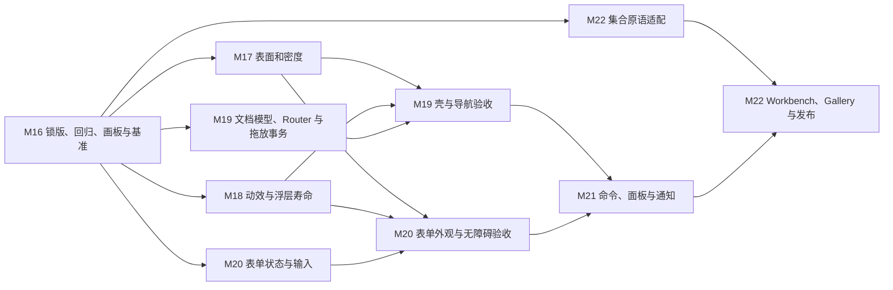

# Phase 3 终极架构审阅、设计精校与执行蓝图

**审阅日期 2026-11-26。建议先冻结窗口、文档、浮层三种状态的所有权，再冻结皮肤。** 例如用户在 A 文档输入半句、滚到第 800 行、切换 B、再关闭 B，A 的草稿和滚动位置必须回来。这个用例同时决定 Tab 的 ID、Router 的边界、焦点归还和虚拟化状态放在哪里。它比给 Tab 加动画更早进入验收。

审阅对象是本仓 `f0b227d` 的 Go 实现，以及工作区中的 [Phase 3 路线图](ROADMAP.md)、[规格 §12](md3e-spec.md) 和 [架构约定](architecture.md)。下文的本仓行号以该提交为准。上游行号默认指根模块和 m2-demo 共同锁定的 `v0.10.1-0.20261119113012-61ea5567ab14`（用 `go list -m -f '{{.Dir}}' github.com/egoist/mygo` 定位）。另在临时目录检出并核验当日远端 HEAD `611bbf74402f`，只在写明“候选”的地方使用新增能力。§5 的 md3e 声明是拟议接口，示例中的 app 字段和方法由应用提供。[锁定上游](https://github.com/egoist/mygo/tree/61ea5567ab14/ui) · [候选上游](https://github.com/egoist/mygo/tree/611bbf74402f/ui)

## 1. Executive Summary & Top 10 Architecture Decisions

| 裁决 | 实现约束 | 最小否决用例 |
|---|---|---|
| ADR-01　一个外壳布局内核 | AppShell 管顶栏/导航/内容/状态栏的几何；AdaptiveScaffold 保留旧签名与默认断点，二者调用同一私有布局函数。WindowTitleBar 独占原生按钮安全区、拖窗、双击最大化 | 缩放至 150%，侧栏从贯顶变为顶栏贯通，编辑器仍有相同的业务状态，窗口控制区可点 |
| ADR-02　导航身份由应用提供 | 稳定 string ID 命名目的地。Sidebar/Rail/底栏投影同一份分组数据。UI 的收起偏好、分组 open、当前路径分开持有 | 在第 2 项前插入一项，选择和键盘焦点仍指原 ID |
| ADR-03　历史属于导航域 | 单页应用一个 Router。需要每个文档可独立 Back 的工作区，每个 Tab 持有一个 Router。TabStrip 只发文档动作；应用拥有文档和活动 ID | 切 A→B→A 不新增历史；A.Back() 不改变 B 的 Location |
| ADR-04　文档寿命跨越页面缓存 | 文档模型持有草稿、编辑缓冲、滚动、焦点槽和选区。页面缓存有界；卸载视图时保存可恢复状态 | 第 12 页返回、关闭后取消、拖出失败均无草稿丢失 |
| ADR-05　一个交互层只有一个关闭裁判 | 轻浮层在逻辑关闭时释放输入；重模态由根遮罩拥有模态和关闭动作。退出时取消子层，视觉尾帧不可重新获取焦点 | Select 在 Dialog 中打开，第一次 Escape 只关 Select；父程序化关闭时子层同帧退出 A11y 树 |
| ADR-06　颜色身份与容器层次独立 | SurfaceStyle 只选中性表面配方。皮肤通过已命名颜色角色、字阶、间距呈现。高对比与状态覆盖按最终相邻像素的配对求解 | 暖橙和紫色均能换强调色，禁用阴影后仍看得清选择、错误、焦点 |
| ADR-07　每个自由度只受一个时钟控制 | hover 用 paint 时钟；位姿用 pose；布局和兄弟重排用 transition；Router 自己过场。同一层的 alpha、宽度不接受双重驱动 | 反向操作不中途跳位，关闭浮层后热键立即归还，静态场景无帧 |
| ADR-08　复用 Base 的输入语义 | key 在构造前交给正确根节点，读取 Base 已提交的值。表单持有草稿，业务写入发生在确认时。所有回调明确是否已提交 | 两遍 build 只提交一次；取消对话框后原值、删除动作次数可断言 |
| ADR-09　按需链接是 API 的一部分 | 新桌面构件进根包；用普通函数和调用方注入的槽。主题、Button、包级初始化不能引用命令目录、路由、图表、媒体或形状全表 | 最小 Button 二进制的 nm 禁止表新增壳、选择器、Toast、RouterView 和 TabStrip |
| ADR-10　升级绑定到可重放的提交 | M16 先锁定候选 SHA，对两个 go.mod、旧消费者及跨平台运行做兼容检查；规格表写清“上游已提供 / md3e 新增 / 延期” | 同一份旧调用示例在升级前后编译。SplitButton 第四返回值仍为 *bool，见 splitbutton.go:71，仓库指南中的四个 Element 应更正 |

## 2. M16–M22 路线图裁决与依赖 DAG

| 波次 | 对原清单的裁决 | 本波交付及退出条件 |
|---|---|---|
| M16 | **Keep** 两模块锁版、TextField 空占位/无标签顶距、Lightbox 入退语义；**Reorder** 画板、关键帧、引用基准和状态往返用例到改视觉之前 | 按版本分别运行同名测试。候选的 SplitSecond/SplitLimits/SplitGap 能直接支撑尾侧面板；Truncated() 读取前一帧可用于省略提示；Accordion 箭头跳过禁用头；Router 保留路径段内的 %2F。锁版后复测 /docs/a%2Fb 的 Param 为 a/b。升级单独提交 |
| M17 | **Keep** SurfaceStyle、Card、MetricCard、CodeBlock、FAB、Dialog、Menu、Sheet、SplitButton、FloatingToolbar、Rail、DataTable、Pagination。**Merge** PillTabs/SegmentedTabs 色槽解析；Switch、Chip、Tag、StatusPill、Button、WindowTitleBar 统一取表面配方 | 按源头审核默认值和业务显式覆盖，保留 Outlined、表单错误和键盘焦点。只更新受颜色或几何变化影响的纯几何黄金图。亮暗/高对比画板与 Windows 默认几何基线齐全 |
| M18 | **Split** L1 paint、L2 锚点、L3 模态、L4 布局、L5 路由；**Keep** Plain/RichTooltip、Menu/子菜单、SplitButton、两种 Dialog/BottomSheet、Drawer、Date/TimePicker、Lightbox、Banner、Tree、Rail、List、PageTransition。**Defer** 虚拟行批量退出 | 对每种寿命选 §4 的单一驱动；TimePicker 是内联内容，在宿主模态上编排；Banner 需持久父级。移除行的 ghost 不应冒充仍存在的数据 |
| M19 | **Merge** 两套 scaffold 布局内核；Rail/NavigationSidebar 共享目的地模型；**Keep** ActionToolbar、StatusBar、RouterView、HistoryButtons、Link、TabStrip；**Split** 拖出请求与真实建窗事务 | 桌面与 wasm 均能开两个文档、撤销关闭、重排、独立 Back。标题栏保留原生模式。侧栏和 Breadcrumb 从当前 route 派生激活态；点击才 Push，渲染时不反推 Push |
| M20 | **Merge** SearchField/SearchBar 的编辑与清除行为，带导航外观沿用 SearchAppBar；**Split** Select 的值、Combobox 的受限选择与 Autocomplete 的自由文本；**Keep** TokenField、Collapsible/Accordion、Form/FormField/SettingsGroup；Dirty Bar 作为应用提交槽 | 输入法组合、候选关闭、禁用、非英语标签、校验关系、保存/取消均通过。单开 Accordion 由应用控制各 open |
| M21 | **Reorder** Popover 关闭规则和 Kbd 格式化契约到 M18/M19 先用，公共组件在本波发布。**Split** Standard SideSheet 与 Modal 生命周期；**Keep** CommandPalette、FindBar、ToastStack、ConfirmDialog/PromptDialog；保留 SnackbarHost FIFO | 命令导航栈可退回；对当前文档执行查找和替换；角落堆叠不抢编辑焦点，Undo 一次。确认/提示框薄封装 AlertDialog，输入存草稿 |
| M22 | **Keep** GridView、OutlineTable、NumberInput、Stepper、EditableText、ColorWell/ColorPicker、DropZone、Workbench、Gallery、性能/DCE/平台终验；**Merge** OutlineTable 直接桥接 ui.OutlineTable；**Split** 类型化进程内拖放与操作系统文件拖入；**Defer** 自研 HCT 编辑面、跨进程 Tab/通用停靠 | 颜色输入先复用 ui.ColorPicker 的 HSVA/Hex（ui/colorpicker.go），可附 tokens 派生样块；外部文件走公开文件拖入接口。Gallery 提供两个实验室；Workbench 提供真实页面、草稿、行检查器和通知闭环 |

M22 的适配以真实调用方式拆任务。GridView 以 *ui.GridState、n、minWidth、height 和按索引构建的回调完成虚拟化；OutlineTable 是泛型，输入 *ui.OutlineState[K]、列、根 key 和取子项函数。NumberInput/Stepper 都绑定 *float64 与上下限、步长，EditableText 绑定 *string，ColorWell/ColorPicker 绑定 *ui.Color。DropZone 接本地类型用 ui.Drop[T]，系统文件用 Element.DroppedFiles()；不以任意路径伪造跨窗文件接收。验收空集合、同键重排、过滤后收缩、只渲染可见区、越界数值和拖放取消，再覆外观。[公开 API](https://github.com/egoist/mygo/blob/61ea5567ab14/ui/api_gen.go#L1634) · [文件拖入](https://github.com/egoist/mygo/blob/61ea5567ab14/ui/drop.go#L11)

**可并行的交付边界。** 一条箭头表示下游实现可以依赖上游已验收的契约。候选源码的 split 极小窗行为尤其重要，两侧最小值之和超出可用宽度会溢出，壳应先切换成单栏或模态。[候选 split.go](https://github.com/egoist/mygo/blob/611bbf74402f/ui/split.go#L127)



M16 建立可复用的 Monitor 切片（原顶栏、两张指标卡、账本、过滤框）。M17 用同一数据和虚拟时钟换肤，M19 接入导航、M20 接入表单、M21 接通知，M22 只需完成跨页串联及发布验证。并行修改者分别拥有 tokens、私有 motion、文档模型或控件代码；相互依赖的签名在 §5 统一评审。

## 3. 桌面视觉、颜色和 Workbench

### 3.1 从截图到表面令牌

两图均为 2012×2053 的提供图像。原图坐标 (900,99) / (1400,405) 采到画布与右上指标卡底，图 1 为 `#0D1511 / #1B211C`，图 2 为 `#151315 / #272325`，相对亮度比分别约 1.13 和 1.19。参考图用很小的明度差就分出了卡片；最突出的三个线索是留白、一个强调色和大号读数。该采样含最终合成与渐变，不作为全应用调色板。上游与本库的颜色计算应在 DIP 布局和最终 sRGB 上分别验收。

**沿用已有 Tone 曲线。** 以下顺序固定为 Lowest / Low / Container / High / Highest，画布 Surface 单列。标准、中、高对应本库的三个 contrast 锚点；中间值沿既有 curve 插值。两种 SurfaceStyle 使用同一表。[tokens/scheme.go](../tokens/scheme.go#L246)

| 模式 | 画布 T | 标准 | 中 | 高 |
|---|---:|---|---|---|
| 暗 | 6 | 4 / 10 / 12 / 17 / 22 | 2 / 11 / 16 / 21 / 26 | 0 / 12 / 20 / 25 / 30 |
| 亮 | 98 | 100 / 96 / 94 / 92 / 90 | 100 / 96 / 92 / 88 / 84 | 100 / 95 / 90 / 85 / 80 |

1. **色相与色度。** `SurfaceTonal=0` 保留 variantPalettes 的中性 N/NV：TonalSpot 为 (H,6)/(H,8)，Expressive 为 (H+15°,8)/(H+15°,12)，Vibrant 为 (H,10)/(H,12)，Neutral 为 (H,2)/(H,2)，Fidelity/Content 为 (H,Cseed/8)/(H,Cseed/8+4)，Monochrome 为 0/0。Expressive 的 +240° 属于 primary。拟议 Neutral 表面沿 N 自身的 hue，目标 C=min(Cn,2)；OutlineVariant 和表面辅文沿 NV 自身 hue，C=min(Cnv,3)；Monochrome 使用现有零色度灰阶分支。Primary/Secondary/Tertiary/Error 及其 On 配对保留原 variant。将低色度验收定义为求解输入，8-bit 灰色反算 CAM16 时受白点和量化影响。若要求特定色度上限，应另测实际色、降低目标或选择中性灰，不能以设计输入冒充测量。
2. **求解。** 在 NewDynamicScheme 内、resolve 之前选定表面色板。通过 HCT.ToColor 的 gamut 求解保 T、压 C；对最终不透明 sRGB 校验亮度次序。OutlineVariant 起始 T 暗 30 / 亮 80，沿现有 normal/medium/high 目标 1/3/4.5 对锚点 SurfaceBright（暗 T24/29/34）或 SurfaceDim（亮 T87/80/75）求解；仅作装饰时可低对比。承担必要边界时换 Outline，实测相邻两面最低比须 ≥3。高对比模式有效边界用 1.5 DIP，焦点环 2 DIP、内外间距 2 DIP。状态填充与底色太接近时增加勾、选中竖条或焦点环。
3. **前景配对。** 普通文字含 placeholder ≥4.5，大字及必要图标/状态标识 ≥3；本库高对比目标为普通文字 ≥7、标识 ≥4.5。白色到暗 T34 的理论上限约 8.07，原 resolve 的 11/21 等是求解目标，不能当实测保证。标准下 T90/T22 理论约 9.55，T30/T90 约 7.24。装饰卡片与画布的相邻色阶无 3:1 要求。[WCAG 文字](https://www.w3.org/WAI/WCAG22/Understanding/contrast-minimum.html) · [WCAG 非文字](https://www.w3.org/WAI/WCAG22/Understanding/non-text-contrast.html)
4. **闭环。** 对角色所用每个背景（含 hover、press、selected、渐变最亮/最暗点）先按渲染器的混合顺序合成为不透明 sRGB，再调用 tokens.ContrastRatio，它自身忽略 alpha。失败时，在同 hue/chroma 的 T=0…100 上按 0.5 枚举，取满足所有配对且离原 T 最近的候选，重算量化结果；无解则拆成局部 On 角色或加不透明承字层。跨亮暗 Oklab 插值若遇黑白前景都达不到 7 的中间灰，直接切换该组前景与承字层。禁用态另留 A11y 标记，不拿豁免稀释可操作态。验收种子使用 Workbench 四色 #E06D1B/#6750A4/#0061A4/#2E6B3E，加 #808080、纯黑白和 Monochrome；遍历各 variant、两种 style、亮暗和三档对比，换肤取 0/.25/.5/.75/1。此矩阵是 M17 发布测试。
5. **缓存与继承。** SurfaceStyle 贯通 ThemeOptions、DynamicSchemeOptions、主题 provenance、schemeCacheKey、高对比重建、动画目标和 Workbench themeSignature，保持 WithPreferences 往返、嵌套 Themed 和 Overlay 的角色一致。不要在每个组件建 TonalPalette，Tone 的逐值 map 不适合对每帧连续浮点做缓存。[theme.go](../theme.go#L545) · [tokens/palette.go](../tokens/palette.go#L91)

### 3.2 默认表面与控件

以下 DIP 数值为 Phase 3 桌面拟议值。静态阴影复用现有 E0/E1/E2/E3：每组为 key 与 ambient 的 (Y, blur, alpha)，X/spread 均为 0。E0 无；E1=(1,2,.30)+(1,3,.15)；E2=(1,3,.30)+(2,6,.15)；E3=(3,5,.30)+(3,10,.15)。先确定容器角色，再独立 ApplyElevationShadows；SurfaceColorForElevation 已选好分层色时不再重复加 tint。仅暗色 E2/E3 浮层可在顶部向内 2 DIP 绘制白色反射 `α(y)=0.035·max(0,1−y/2)²`，裁在圆角内；高对比或亮色置零。[surface.go](../surface.go#L16) · [tokens/elevation.go](../tokens/elevation.go#L40)

| 元件 | 默认角色 / 圆角 | 强调、输入和边界 |
|---|---|---|
| Card Elevated / Filled / Outlined | Low / Low / Surface；20 / 20 / 16 | E1 / E0 / E0；可点 Elevated hover 到 E2；Outlined 仍有 1 DIP；非交互卡用间隔。显式 Hairline 保留 |
| MetricCard / 旗舰主卡 | Low / Container；20 / 28 | E0 / E1，曲线下填 α=.10→0，末点仅实时打开；主卡最多一处 primary 装饰。CodeBlock 用 Container、12、E0 |
| PillTabs / SegmentedTabs | 暗槽 Lowest，亮槽 Container；色彩胶囊用 Primary 或 PrimaryContainer 配对应 On；中性胶囊暗 High、亮 Lowest | 高 36/32、内缩 3、全圆、E0；普通文字配对 4.5，选中图形另过 3。中性色阶不够时补勾，徽章共用文字色；移除槽与胶囊双边 |
| DataTable | Low 底、Container 表头，16；行圆角 8 | E0；38 DIP 行，数值 End/tnum，可选斑马纹 OnSurface α=.03；选中用 SecondaryContainer+勾；仅排序列保留指示，列宽手柄在 hover/focus 出现 |
| Dialog / Menu / Popover | High；28 / 12 / 16 | E3 / E2 / E2；模态 scrim 黑 .32；菜单键盘高亮有明确定点；次菜单不叠加第二层 scrim |
| SideSheet | Standard Container，Modal High | Standard E0，内容边界柄 4、命中 12；Modal E3、内侧角 20、外缘 0，RTL 镜像 |
| 其他 | FAB 用 PrimaryContainer/E2；Toolbar 用 Low/E1；Rail/TitleBar 接画布或 Low | SplitButton 靠 2 DIP 接缝；Switch 保留可辨轨道和 thumb；FilterChip 选中保留勾，Tag/StatusPill 默认去框，Outlined 保留。Pagination 只强调当前页；按钮保留显式 Outlined |

现状有两处必须分开验收。Card 的 Hairline 是 bool，零值已经无框；MetricCard 的 nil 默认值和 Workbench 显式 true 需要分别修改。标准暗色 Expressive 的 PrimaryContainer 初始 T30，PillTabsTonePrimary 槽取 Highest T22；色阶原值并不支持「任意暗色主题下槽一定更亮」。T30 与 T22 本身只有约 1.3:1，足以出现难分层的观感；把槽、胶囊、边缘及内容分别取样，才能确定特定图上的合成效果。圆角表中的 8/12/16/20/28 分别直接用 ShapeSmall/Medium/Large/LargeIncreased/ExtraLarge，避免新增平行的半径表。[CardOptions](../card.go#L49) · [PillTabs 实际配对](../pilltabs.go#L172) · [角色 tone](../tokens/scheme.go#L294) · [形状令牌](../tokens/shape.go#L21)

### 3.3 Workbench 迁移样板

- **密度基线。** DensityDesktop 现有 ControlScale/PaddingScale 均为 .85，SpacingUnit=3.5 DIP，单行列表/文本框 44、主 Tab 40。壳与卡片间距可独立定义，正文只随 TextScale 放大，避免在字号和控件高度上重复乘密度。[density.go](../tokens/density.go#L58) · [type.go](../tokens/type.go#L26)
- **布局。** 桌面 56 DIP 图标栏（舒展档 64，旧组件默认 80）、展开 192；标题栏 40 且至少容纳系统安全区。内容外边距 24、卡片间隔 16、内部 16–20、标签和值间隔 4。内容宽度 ≥840 时 4 列，主卡占 2、上下行各占 1；600–839 用 2 列，主卡跨 2；<600 用单列，搜索单独一行，表格保留主列，检查器模态。断点量实际剩余 DIP，字体放大导致排不开时允许提前换行。
- **层级。** 页面标题 HeadlineMedium 28/36/500，KPI DisplaySmall 36/44/500，紧凑时 28/36/500；卡标题 TitleMedium 16/24/600；单位、时间、峰值用 BodySmall 12/16/400；表正文 BodyMedium 14/20/400。顺序是字号/行高/字重。数字启用已有 TabularNums，单位独立对齐基线，只给域名和标识符按需用 MonoFont。切换 9.9→10.0 单位列不跳动，TextScale=2 时改上下排。
- **信息。** 顶栏只留页名、搜索/命令入口和原生窗口操作。种子、密度、动效、RTL 进入设置；StatusBar 只显示采样状态和最近更新时间。默认 Workbench 采用 Nebula + TonalSpot + SurfaceNeutral，系统明暗可覆盖，封面取色限定 Media 局部。主卡只保留引擎状态和一个主要动作；路由模式、TUN、Fake-IP 放同一控制行。上下行共用一个图例，曲线用线型或端点区分；去除重复 Live、Desktop、协议徽章与截成相同字符串的 Aggregated…。
- **账本。** 连接 / DNS 页签显示实际数量；查询框用单一可见提示并有稳定 A11y 名称；筛选放尾侧，窄窗折入 Popover。行主键取 recordID，选一行在 SideSheet 展示完整主机、协议、路由和复制操作；保留键盘打开、关闭归还行。明示吞吐为模拟采样，内存取真实 runtime.MemStats。参考图仅借用布局秩序。Workbench 显式 Hairline 位于 monitor.go:271、393、508、700，只改组件 nil 默认不会改变这些位置。[monitor.go](../examples/workbench/monitor.go#L386) · [数据源](../examples/workbench/monitor_data.go#L491)

## 4. Motion Choreography 与上游边界

### 4.1 谁在动画，谁还在接收输入

| 场景 | 锁定源码的实际行为 | 实施决定 |
|---|---|---|
| 有 key 的子元素 | transition.go:601、694、906 检查生灭、上一帧布局、父 ID；首帧整树新建通常不播 Enter；父也移除、Hidden、尚在 AfterExits 等待、负 ExitDuration 等情形可以没有 ghost。相同 ID 重现可从离场位置回接 | 常驻 stage，切换其直接子节点。窗口 resize 的布局不做一般补间；重复同 key、快速 A→B→A、父子同帧移除分别测试 |
| Overlay / PopoverBase / MenuBase | widgets.go:649 临时切换到窗口 overlay 根并继承方向和主题。最后一个浮层也能退场，见 overlay_transition_test.go:15、75。PopoverBase 根 panel 直接挂层，关闭时返回无效 Element；普通 outside press 仍送达底层。MenuBase.Popup 在关闭时停止构建，面板 ID 由 trigger+level 派生，支持滚动子菜单；键盘焦点逻辑由 popup 自己处理 | 在 panel 存在时注册完整 Enter/Exit。调用者的 key 在稳定外壳消费；自画的 overlay 直接子节点另按 opener 的持久标识区分。不要重建第二套 Menu 键盘处理。[base.go](https://github.com/egoist/mygo/blob/61ea5567ab14/ui/base.go#L649) · [popovermenu.go](https://github.com/egoist/mygo/blob/61ea5567ab14/ui/popovermenu.go#L441) |
| DialogBase / 多层关闭 | base.go:692 的 panel 实际是 Modal backdrop 的子元素；两者一同撤下时，仅在 panel 上设 Exit 无法找到存活父节点。scope.go:199 的 OverlayShortcut 按层处理；PressedOutside 识别 attached 子浮层，但独立的 Snackbar 不在附着链上。ghostOf 清除 modal、焦点和输入处理器 | 全屏淡出可注册在 backdrop；独立 scrim/面板曲线由常驻 host 的两个视觉通道负责。一旦关闭，撤 Modal、隔离输入和 A11y，清除子浮层；由上游或一个明确的 opener 归还一次焦点，必要时退回当前文档标题。保持一个仍可交互的“退出中”模态会延迟/抢回焦点 |
| Layout / Scroll | Collapse 是 **ui.Motion.Collapse**，沿父布局主轴收拢；Width/Height 则是 ElementTransition 选择的布局属性。Exit 副本在原父级内，裁剪和滚动仍生效；仅 ghost 变小不足以使兄弟平滑移动。AfterExits 仅等待同父的退出兄弟；新节点已占位但在等待期间不可获焦，自动聚焦请求要验证是否在显示时恢复 | 常驻行/列对真实兄弟用 Position/Size 或稳定容器高度；内容选 Clip。重排只给可见且 ID 稳定的行；滚离视口、过滤 100K 行或行 wrapper 被回收不逐一播放 Exit。离屏移除前已启动的引擎通道不能靠 Draw 里的 return 取消 |
| AnimatePose / Match | pose.go:28、91、120：首次 pose 直接就位，后续变更可只重绘；Fade=0 表示不透明，Motion.Opacity=0 表示透明。Pose 不改变占位，ReduceMotion 仍允许 Fade。Match 是 ElementTransition.Match 可比较值，Fly 将元素提升到窗口或当前 overlay 的飞行层，越过祖先 clip；上游有专门的匹配/绘制路径 | rail 的实际宽度必须由布局动画驱动；箭头旋转可用 pose。英雄元素用私有结构体 {DocID,ItemID}，源和目的在相邻帧相遇，最多一对可见匹配；来源滚没、换窗或缺 ID 时退化淡入。md3e.ImageOptions.MatchKey 已经设置 Match/Fly，勿再覆盖其 Transition。[pose.go](https://github.com/egoist/mygo/blob/61ea5567ab14/ui/pose.go#L28) · [match.go](https://github.com/egoist/mygo/blob/61ea5567ab14/ui/match.go#L461) |
| Router | router.go:608–646 中 Match 与有方向的滑动会构建离开和进入的两页，离开页 inert；同级 Fade 分支只构建新页。双页过渡中的旧页仍执行 view 回调，调用方须约束业务副作用。TransitionAuto 根据路径深度，系统减少动态时可继续淡变；TransitionMatch 有自己的匹配过渡 | RouterView 只选上游一条过场；不用 PageTransition 包第二次。非路由的插槽替换才用 PageTransition。两类页面均禁止在 build 中无条件发通知、发起 IO 或推进模拟计时 |
| Collapsible / Accordion | collapsible.go:31、54 的 Trigger 已用 200ms 驱动 Progress，Panel 在过程里仍建内容并裁切。AccordionBase.Item 复用它，并维护 headers 的键盘顺序 | 常规折叠直接消费 Progress，箭头转 90°×Progress，RTL 反向。严格主题级 ReduceMotion 若公开 Base 仍启动内部通道，需在上游补可禁用的动画选项，或在该模式走具名 Disclosure+静态面板，测试键盘和 A11y 等价。严禁叠第二条高度弹簧 |

**私有助手提案。** 根包按调用拆小函数，motion 包只生产数值。无包级回调表，无通用组件 registry。以下为内部边界，paintRamp 与 presence 各自绑定宿主 ui.Local。位姿和 ghost 不共享可变的画笔缓存。

```go
type paintRamp struct {
	from, to, value float32
	started         time.Time
	duration        time.Duration
}

func (r *paintRamp) sample(now time.Time, target float32, reduce bool) (value float32, moving bool)

type presence struct {
	phase    presencePhase // hidden, entering, open, exiting
	epoch    uint64
	started  time.Time
	from, to float32
}

func (s *presence) update(now time.Time, open, reduce bool) (paint, interactive bool)
func anchoredTransition(enter, exit time.Duration) ui.ElementTransition
func staggerDelay(visibleOrdinal int) time.Duration
```

- **L1** 当前 alpha 先在旧曲线上按 now 采样；目标翻转时从该值重启，时长按剩余幅度比例缩短（下限一显示帧，上限见下表），到时精确写目标、moving=false。hover/press 只在 DrawOver 读取。无效句柄绘制最后的静态快照并返回；不可见时不采事件也不约下一帧；重现时按绝对时间求本帧并清理过期波纹。需要局部重绘时才 p.AnimationFrame()，定时显示 Tooltip 才 p.After(deadline−now)。目前 exp(-28t) 从 .08 衰减至 .0015 约需 142ms，“50ms”不能当既有真实时长。
- **L2/L3** 单一 host 保存 presence、epoch、返回焦点的 Handle、pending action。输入事件只改变 open/草稿；open 边沿递增 epoch，退场重开时丢弃旧 epoch 的结束回调。present=true 时才建视觉层，interactive 只随 open；不可用“多建一帧”恢复已经提交的输入。减少动态效果的有效值取 theme.ReduceMotion || 系统偏好：在 paint 跳到目标，build 层 Jump 并移除延迟/pose 修饰；ReduceMotion 关闭路径直接完成清理，无条件 Invalidate 应删除。
- **严格零帧的边界。** 若整窗请求立即收敛，壳可在构建通道前调用 c.DisableAnimations()，读取端可查 c.Instant()。它影响当前窗口整帧，不能在局部组件内拿来实现主题覆盖；它也不负责停止独立的 Keyframes/Timeline、手写 paint 时钟。上游 Router.show 在开启新过场时检查 instant，已在离场的同页路径则继续 advance 旧通道。测试需分别覆盖“改变目标时关闭动效”和“目标不变时中断”。[context.go](https://github.com/egoist/mygo/blob/61ea5567ab14/ui/context.go#L535) · [router.go](https://github.com/egoist/mygo/blob/61ea5567ab14/ui/router.go#L592)
- **退出中的副本。** transition.go:359 的 ExitDuration=0 表示继承；负值才要求即时，Animation.Delay 默认也影响 exit，错峰退出须明确 ExitDelay<0。旧帧保存的 Exit 可能在本帧撤节点时才被引擎读取，且已建立的 ghost 可能继续动。要求“中途切 ReduceMotion 当帧静止”的组件，以受控 presence 持有可撤的视觉子树；在 stable parent 下换该视觉 stage 的代际以一并丢弃旧 ghost（实测确认父 ID 已消失）。Router 选 TransitionNone 可阻止新过场，但既有 routeView 的 leaving/progress 私有，暴露限制并在 M16 立中途取消用例；若不能取消，先向上游补受控结束接口。弹簧 Resolve 的 1ns Snap、NonMotion 或省略下一次请求都不能证明立即静止。
- **绘制寿命。** ghostOf 复制节点及子树、保留 draw 函数，Go 闭包捕获的模型指针仍是活的。入退帧预先捕获颜色、边界、值、文字和时间采样；不可在 ghost 内查询 live element 或继续操作过期 slice。与交互相连的控件必须在 inactive 层屏蔽键鼠和读屏。只对虚拟行避开动画仍不足以保证离屏零帧；基于 pose/Transition 的长动画须用布局/可见性边界在进入前抑制，已离屏运动要在支持的驱动上显式结束。[transition.go](https://github.com/egoist/mygo/blob/61ea5567ab14/ui/transition.go#L906) · [motion.go](../motion/motion.go#L170)

### 4.2 时序配方与可测判据

曲线使用 ui.CubicBezier。O=(.20,0,0,1)，I=(.40,0,1,1)，S=(.20,0,.20,1)。时间为明确时长；弹簧使用单位质量、物理阻尼 c=2ζ√k。Expressive/Standard 均沿用 motion.SpecOf，桌面工具可选 Standard。opacity 一律钳位 [0,1]。

| 层 | 入场、反向与退场 | 原因与断言 |
|---|---|---|
| L1 状态 | hover 0→.08，140ms O；离开 180ms O；focus/press .10，drag .16。按压角和 thumb 用 FastSpatial，Expressive (ζ=.6,k=800)，Standard (.9,1400)。ripple 半径 220ms O，释放 alpha 120ms I | 短位移可略过冲；文本/颜色只用单调曲线。2Hz 数据更新关闭时单独扫过 20 个按钮，build 次数不增加（纯 hover 路径），每个终态恰等目标 |
| L2 锚定面板 | 180ms O，scale .95→1、Y=-6→0，Flip；130ms I，scale 1→.97、Y=−3、alpha→0。键盘 Tooltip 即显信息，指针驻留延时沿用 TooltipBase | 面板靠近锚点，小距离能辨别来源。上翻时位移符号相反，进入和退场四分点透明度单调 |
| L3 模态 | 面板 DefaultSpatial：Expressive (.8,380,c≈31.19)，Standard (.9,700,c≈47.62)，scale .94→1 或 sheet 由尾侧入；scrim 0→.32 用 DefaultEffects (1,1600,c=80)。退场面板及 scrim 均 160ms I，避免回弹 | 大面板最多轻微越过目标；关闭从当前采样反向，alpha 不反亮。FastEffects (1,3800,c≈123.29) 适合可重定向的小淡变，无固定 160ms 承诺 |
| L4 结构 | 常驻 rail 56↔192 用 DefaultSpatial、宽度钳住可用区；可移除分支在稳定列内 200ms S 展开，180ms I 收拢，Opacity:1 保持文字清楚。既有 Collapsible 用 Base 的 200ms 单通道 | 动画时兄弟随真实宽/高移动；折叠后隐藏子节点不可 Tab。按钮切换立即更新 Expanded；收起前若焦点在面板内先回 header |
| L5 页面 | 独立 FadeThrough：旧页 90ms I→0，再新页 180ms O 从 .98→1，AfterExits；SharedAxis 移动 24 DIP、横轴乘方向符号，用 DefaultSpatial，退出 120ms I。Router 跨详情的 Hero 用 TransitionMatch 配 300ms S；同级普通路由可选内建 Fade。首次显示的可见卡片 Delay=min(20ms×ordinal,120ms) | FadeThrough 无两份正文叠字；Hero 的源、目标必须在同窗口；排序或滚动回收行不给入场 Delay |

**关键帧测试契约。** 用 ui.NewTester 建可见、无文字依赖的实色面板，先静止再打开。每段按绝对采样点 t=0、D/4、D/2、3D/4、D 推进差值，避免误把五个 Advance 都当绝对时间。每点从面板中心与 scrim 的已知合成色反推 alpha（允许 2 个 8-bit 码值的量化误差），从边缘扫描包围盒（容差 1 物理像素）；校验上表的曲线值、位移方向和终点。O/I/S 的时间四分点（25%/50%/75%）对应的归一进度分别为 0.607 / 0.878 / 0.975、0.099 / 0.325 / 0.630、0.448 / 0.814 / 0.962；按真实时间解贝塞尔的 x，再取 y。弹簧样本用 motion.SpecOf(scheme, token).SettleTime() 定观察窗口，比较通道位移/目标和 overshoot 上界（零初速 .8 阻尼比约 1.52%，.6 约 9.48%），中途反向另测连续性。Exit 中立即检查旧控件点击/Tab/AccessByRole 均不可激活；保留的像素持续至规定时刻。重复打开、半途中断、上翻、滚出后返回、theme-only/system-only ReduceMotion、关闭同时切偏好均单独测试。计数 view builds 与 paints，检查 FramePending()，再推进超过原终止时间排除残留定时器；关掉 caret 闪烁、消息超时和外部采样等无关时钟。手动画板可含文字，自动 Golden 只放纯几何。[上游 overlay 像素用例](https://github.com/egoist/mygo/blob/61ea5567ab14/ui/overlay_transition_test.go#L15) · [pose 测试](https://github.com/egoist/mygo/blob/61ea5567ab14/ui/pose_test.go)

## 5. 五大桌面骨架的 Go-First API

以下声明在包 md3e 内。每个 opts 接受 0 或 1 项，多项 panic；必需的指针拒绝 nil，可选项写明回退。每次 build 传入的视图槽同步调用，库不得把槽存进应用状态。可以长期保存的动作回调只捕获应用模型/Services。例中的 `a` 为窗口模型。已有公开签名逐项保留，用带字段名的 Options 示例；新增公开 struct 字段会影响外部无字段名复合字面量，旧消费者编译夹具纳入 M16。

### 5.1 壳、两种导航投影、工具栏和状态栏

```go
type ShellLayout uint8

const (
	TopBarAcross ShellLayout = iota
	SidebarToTop
)

type AppShellOptions struct {
	Layout                       ShellLayout
	TitleBar, Navigation, Status func()
	Zoom                         float32 // 0 表示沿用窗口当前值
}

func AppShell(c *ui.Context, content func(), opts ...AppShellOptions) ui.Element

// 已有签名；NavigationRailOptions 拟增 IconOnlyWidth float32、Footer func()、ShowToggle bool。
func NavigationRail(c *ui.Context, destinations []NavigationDestination, opts ...NavigationRailOptions) ui.Element

type NavItem struct {
	ID, Label, Badge string
	Icon             IconDraw
	Menu             func(*ui.Menu)
}
type NavGroup struct {
	ID, Label string
	Open      *bool
	Items     []NavItem
}
type SidebarOptions struct {
	Label         string
	Expanded      *bool
	Footer        func()
	OnSelected    func(string)
	IconOnlyWidth float32
}

func NavigationSidebar(c *ui.Context, selected *string, groups []NavGroup, opts ...SidebarOptions) ui.Element

type ToolbarAction struct {
	ID, Label string
	Icon      IconDraw
	Disabled  bool
	Run       func()
}
type ToolbarOptions struct{ Label string }

func ActionToolbar(c *ui.Context, actions []ToolbarAction, opts ...ToolbarOptions) ui.Element

type StatusBarOptions struct {
	Label    string
	Trailing func()
}

func StatusBar(c *ui.Context, leading func(), opts ...StatusBarOptions) ui.Element
```

```go
md3e.AppShell(c.Key("workspace"), func() {
	a.buildDocumentArea(c)
}, md3e.AppShellOptions{
	Layout: md3e.SidebarToTop, Zoom: a.zoom,
	TitleBar: func() { md3e.WindowTitleBar(c, a.titleOptions(c)) },
	Navigation: func() {
		md3e.NavigationSidebar(c, &a.destination, a.groups, md3e.SidebarOptions{
			Expanded: &a.expanded, IconOnlyWidth: 56, Label: "工作区",
			OnSelected: a.navigate,
		})
	},
	Status: func() { md3e.StatusBar(c, func() { ui.Text(c, a.status) }) },
})
```

壳根先消费 key，再布置固定父节点；两种布局下内容保持同一父链（可用共享 grid 槽位），内容宽度扣实际可见导航宽及尾侧面板。顶栏读取 c.TitleBar() 的物理左右安全区，sidebar-to-top 亦避开系统按钮；拖窗区域排除用户按钮。c.Vibrancy() 只查询背景可透出的能力；由应用窗口选项启用，窗口透明时增加不透明回退。SetZoom 在壳内最多写一次且仅值变化时写；c.Size()/Bounds/输入均为内容 DIP，不乘设备比例。[shell.go](../shell.go#L135) · [上游 zoom.go](https://github.com/egoist/mygo/blob/61ea5567ab14/ui/zoom.go#L15)

展开用 ui.Sidebar/SidebarSection，其角色是 Tree、选中 string、支持首字母导航；SidebarItem 接收 *ui.SVG 且自己绘制 label。外部 IconDraw 不能冒充 SVG。支持自绘图标的投影应使用具名 TreeBase/Item 加图标绘制与同等键盘/type-select 测试，或围绕现成 SidebarItem 添加图标子槽并验证排版。收起时复用 Rail 布局和 tooltip，按 ID 映射 index；同一目的地在同一帧只有一个可操作投影。旧 Rail 默认 80；新 icon-only 为 56–64；Compact 投影成底栏/更多菜单。nil Expanded 用组件局部状态，组 Open=nil 常开。切换投影时按稳定 ID 重绑目的地的 Handle；当前焦点位于子项时才转给新投影。工具栏交给 ui.Toolbar 识别具名按钮、末尾溢出和 roving focus；自定义盒子不自动变成可执行的菜单项。StatusBar 普通文本不随每个采样播报，仅离散状态变化使用 RoleStatus。[sidebar.go](https://github.com/egoist/mygo/blob/61ea5567ab14/ui/sidebar.go#L42) · [toolbar.go](https://github.com/egoist/mygo/blob/61ea5567ab14/ui/toolbar.go#L31)

### 5.2 Router、历史与多文档

```go
type RouterViewOptions struct {
	Transition *ui.Transition
	Animation  *ui.Animation
}

func RouterView(c *ui.Context, r *ui.Router, page func(*ui.Route), opts ...RouterViewOptions) ui.Element

type HistoryOptions struct{ Label string }

func HistoryButtons(c *ui.Context, r *ui.Router, opts ...HistoryOptions) ui.Element

type LinkOptions struct{ Label string }

func Link(c *ui.Context, text, target string, opts ...LinkOptions) ui.Element

type DocumentTab struct {
	ID, Title     string
	Icon          IconDraw
	Dirty, Pinned bool
}
type TabStripOptions struct {
	Label                    string
	OnSelect, OnRequestClose func(id string)
	OnNew                    func()
	OnPin                    func(id string, pinned bool)
	OnMove                   func(id, beforeID string)
	OnDetach                 func(id string, at ui.Point)
}

func TabStrip(c *ui.Context, active *string, tabs []DocumentTab, opts ...TabStripOptions) ui.Element
```

```go
md3e.TabStrip(c.Key("documents"), &a.active, a.tabs, md3e.TabStripOptions{
	Label: "已打开文档", OnNew: a.newDoc, OnSelect: a.selectDoc,
	OnRequestClose: a.askClose, OnPin: a.setPinned,
	OnMove: a.moveBefore, OnDetach: a.requestWindow,
})
if d := a.docs[a.active]; d != nil {
	md3e.HistoryButtons(c.Key("history"), d.router)
	md3e.RouterView(c.Key(d.id), d.router, func(r *ui.Route) {
		r.Title(d.title)
		d.buildPage(c, r)
	}).Fill()
}
```

- 应用持有有序 tabs 与 ID→文档模型。ID 稳定非空唯一；每个模型持久创建 NewRouter(initialLocation)。TabsBase 需要 *int 和数量；每 pass 从 active ID 投影索引，在所有 Tab(i) 完成输入后立即按当次序列映回 ID，只对真实变化回调一次。tab key 取 ID，删除/增排动作在枚举结束后派发。pinned 固定前缀，普通项不能拖入其中；beforeID="" 表示本分区末尾。关闭活动项优先相邻右侧再左侧，最后一项关闭后 active=""；脏文档由应用确认，确认前保留记录。批量关闭先生成 ID 快照，再做一次脏项确认。
- 中键用 HandleInput 的 Button=2，匹配按下/释放、同一 ID、未取消和未越过拖动阈值才发关闭；Button=1 留给 ContextMenu，主键拖动与点击互斥。关钮独立 hit target 和具名 A11y，避免嵌套激活两次。超宽 Tab 列横向 Scroll＋全部文档菜单，新建与溢出钮固定。物理拖放是 Element.Drag(value)、`ui.Drop[T](el)`、el.DragMissed()，最后一项在下一帧返回窗口坐标 (Point,bool)，须与同一坐标系的窗口矩形比较。仅越窗才转 OnDetach；内部空白松手不建窗，Escape 取消。应用在目标窗口接管文档成功后才移除源项，失败保留原位置；新窗口重建 Router/Handle 并迁移业务快照。上游没有导出完整历史序列化，承诺迁移当前 Location；若产品要求跨窗完整历史需应用显式持有导航日志。[dragdrop.go](https://github.com/egoist/mygo/blob/61ea5567ab14/ui/dragdrop.go#L68) · [TabsBase](https://github.com/egoist/mygo/blob/61ea5567ab14/ui/base.go#L256)
- Router 的 history 上限 **100 条**；keep 在每个仍参与构建的视图层级保留邻近最多 **10 个额外页面**，同一路径仅 query 不同的条目可共用页面。卸载整个 Tab 后仅保留 Router 指针无法保住任意 ui.Local。文档持有 draft、每页 ScrollState/ListState、稳定 focusSlot、选区；离开前读取 TextSelection，回到页面用 TrackScroll 和一次性 SetTextSelection/已重绑的 Handle.Focus(c) 恢复。富编辑器的撤销栈由其文档模型持有；IME 正在组合时等提交或明确取消后切换。区分从 TabStrip 键盘导航（焦点留在 tab）和返回正在编辑的文档（恢复编辑焦点），不得每帧强取焦点。
- RouterView 的 nil Transition/Animation 沿用 Router 原值；覆盖期间只允许同一 router 一个挂载点。ReduceMotion 使用 TransitionNone；持久配置与临时覆盖要保存/恢复，避免污染下次挂载。嵌套路由使用匹配 {rest...} 后的 Route.View。历史按钮直接复用 BackButton/ForwardButton，自带最多 15 项的右键菜单。内部 Link 放在 Router.View 构建的页面内，侧栏在外则显式 Push。只有第一个 Router 获得窗口级后退快捷键，wasm 的第一个 Router 还认领浏览器历史；Web 入口用稳定的窗口 Router 管 URL/活动文档，文档内部历史只在显式设计为独立导航域时启用。应指定浏览器后退改变窗口路由、文档按钮操作文档历史；勿让两个域同时处理同一返回事件。[router.go](https://github.com/egoist/mygo/blob/61ea5567ab14/ui/router.go#L177) · [导航文档](https://github.com/egoist/mygo/blob/61ea5567ab14/docs/ui/navigation.md)

### 5.3 搜索、选择、补全与结构化表单

```go
type SearchOptions struct {
	Label, Placeholder, ShortcutHint string
	Suggestions                      []string
	Disabled                         bool
	OnChanged, OnSubmit              func(string)
}

func SearchField(c *ui.Context, query *string, opts ...SearchOptions) ui.Element
func SearchBar(c *ui.Context, query *string, opts ...SearchOptions) ui.Element

type SelectChoice[T comparable] struct {
	Value        T
	Label, Group string
	Icon         IconDraw
	Disabled     bool
}
type SelectOptions[T comparable] struct {
	Label     string
	Variant   TextFieldVariant
	Open      *bool
	Disabled  bool
	OnChanged func(T)
}

func Select[T comparable](c *ui.Context, value *T, choices []SelectChoice[T], opts ...SelectOptions[T]) ui.Element

type CompletionOptions struct {
	Label, Placeholder string
	Disabled           bool
	OnChanged          func(string)
}

func Combobox(c *ui.Context, selected *string, choices []string, opts ...CompletionOptions) ui.Element
func Autocomplete(c *ui.Context, value *string, suggestions []string, opts ...CompletionOptions) ui.Element

type TokenFieldOptions struct {
	Label     string
	Query     *string
	Disabled  bool
	OnChanged func([]string)
}

func TokenField(c *ui.Context, values *[]string, suggestions []string, opts ...TokenFieldOptions) ui.Element

type DisclosureOptions struct {
	Disabled  bool
	OnChanged func(bool)
}

func Collapsible(c *ui.Context, label string, open *bool, body func(), opts ...DisclosureOptions) ui.Element

type AccordionSection struct {
	ID, Title string
	Open      *bool
	Disabled  bool
	Body      func()
}
type AccordionOptions struct {
	Label      string
	SingleOpen bool
}

func Accordion(c *ui.Context, sections []AccordionSection, opts ...AccordionOptions) ui.Element

type FormOptions struct {
	Dirty               *bool
	CanSubmit           func() bool
	OnSubmit, OnDiscard func()
}
type FieldOptions struct{ Description, Error string }
type SettingsGroupOptions struct{ Description string }

func Form(c *ui.Context, body func(), opts ...FormOptions) ui.Element
func FormField(c *ui.Context, label string, control func(), opts ...FieldOptions) ui.Element
func SettingsGroup(c *ui.Context, title string, body func(), opts ...SettingsGroupOptions) ui.Element
```

```go
md3e.Form(c.Key("preferences"), func() {
	md3e.SettingsGroup(c.Key("network"), "网络", func() {
		md3e.FormField(c, "模式", func() {
			md3e.Select(c.Key("mode"), &a.draft.mode, a.modes)
		})
		md3e.FormField(c, "解析器", func() {
			md3e.Autocomplete(c.Key("resolver"), &a.draft.resolver, a.knownResolvers)
		}, md3e.FieldOptions{Error: a.resolverError()})
		md3e.TokenField(c.Key("domains"), &a.draft.domains, a.domains,
			md3e.TokenFieldOptions{Label: "匹配域名", Query: &a.domainQuery})
	})
}, md3e.FormOptions{Dirty: &a.dirty, CanSubmit: a.valid, OnSubmit: a.save, OnDiscard: a.restore})
```

- **文本归属。** 搜索指针和自由补全指针保存每次编辑；严格 Combobox 的 selected 只在选中合法项时提交，局部 query 允许暂时不匹配，失焦恢复已提交值。上游 ComboboxBase.Input 绑定编辑串，Popup 内 Item(value)，枚举结束后 Chosen() 读选择；别让同一 *string 同时充当草稿和已提交值。SearchBar 只换外观；无建议时复用 SearchField 的清除和 Escape 语义；有建议时第一次 Escape 收建议，下次清空。原生 SearchField 把内置占位写到内层 editor；定制占位时用可达的同一个编辑 Base，每帧写，包括空串。OnSubmit 与候选确认只派发一个意图。TokenField 的可选 Query 指向正在编辑的文本；保留上游回车/分隔符与空查询 Backspace 行为，添加前按产品规则判重；传给 OnChanged 的切片提供独立快照。[编辑、补全和搜索](https://github.com/egoist/mygo/blob/61ea5567ab14/ui/combobox.go#L348) · [TokenField](https://github.com/egoist/mygo/blob/61ea5567ab14/ui/combobox.go#L512)
- **选择与折叠。** SelectBaseOpen 的 Trigger 消费控件 key；Open=nil 使用 SelectBase 的本地开关。每个可选值唯一；组标题单独渲染，不占选项索引。选项支持方向键、禁用跳过，首字母跳转要绑定在焦点范围内，按提交文本而非原始字节匹配，从当前项之后循环，以 Highlight 更新游标，Enter 才提交。每帧对可持久属性写全值，校验禁用切换后鼠标、键盘均不能提交。CollapsibleBase 公开 Trigger、Progress() 和 Panel(fn)，AccordionBase.Item(open) 管 header 间导航。箭头和面板采同一 progress；SingleOpen 在当前 header 真正打开时一次关闭同组其他指针，重复 build 不触发选择。外部一次设多个 true 时按稳定声明顺序留第一项。[SelectBase](https://github.com/egoist/mygo/blob/61ea5567ab14/ui/base.go#L395) · [Collapsible 与 Accordion](https://github.com/egoist/mygo/blob/61ea5567ab14/ui/collapsible.go#L31)
- **表单归属。** SettingsGroup 使用 Fieldset(legend)，需要行标签对齐的每一组在同一 Form 作用域内构建。Field 会寻找可聚焦控件/组，组合控件要验证最终名称、描述、错误关系均到达实际编辑器。Error 从非空变空要清理关系，窄窗转上下排仍只有一份编辑器。Dirty 由应用比较草稿与基线（示例 a.dirty 是这个比较的结果），成功保存后才替换基线；保存失败保留草稿与 dirty。OnDiscard 恢复基线；CanSubmit=nil 表示可提交。通用 Form 不反射业务对象，提交条只在有动作时出现。[form.go](https://github.com/egoist/mygo/blob/61ea5567ab14/ui/form.go#L35)

### 5.4 Popover、可调宽检查器、命令与查找

```go
type PopoverPlacement struct{ At, Self ui.Anchor }
type PopoverOptions struct {
	Label     string
	Placement *PopoverPlacement
	MinWidth  float32
}

func Popover(c *ui.Context, trigger ui.Element, open *bool, body func(), opts ...PopoverOptions) ui.Element

type SideSheetMode uint8

const (
	SideSheetStandard SideSheetMode = iota
	SideSheetModal
)

type SideSheetOptions struct {
	Mode                           SideSheetMode
	Label                          string
	Width                          *float32
	ContentMin, MinWidth, MaxWidth float32
}

func SideSheet(c *ui.Context, open *bool, main, detail func(), opts ...SideSheetOptions) ui.Element

type KeyChord struct {
	Mods ui.Modifiers
	Key  ui.Key
}
type KbdOptions struct{ AccessibleLabel string }

func Kbd(c *ui.Context, chord KeyChord, opts ...KbdOptions) ui.Element

type Command struct {
	ID, Label, Group string
	Keywords         []string
	Shortcut         KeyChord
	Disabled         bool
	Children         []Command
	Run              func()
}
type PaletteOptions struct {
	Label  string
	Recent *[]string
	OnRun  func(id string)
}

func CommandPalette(c *ui.Context, open *bool, commands []Command, opts ...PaletteOptions) ui.Element

type FindOptions struct {
	CaseSensitive, Regex *bool
	Replacement          *string
	OnReplace            func(all bool)
}

func FindBar(c *ui.Context, open *bool, query *string, matches int, current *int, opts ...FindOptions) ui.Element
```

```go
if c.Shortcut(ui.Cmd, ui.KeyK) {
	a.commandsOpen = true
}
md3e.SideSheet(c.Key("inspector"), &a.inspect, func() {
	a.buildLedger(c)
	md3e.FindBar(c.Key("find"), &a.findOpen, &a.query, a.matches, &a.matchIndex,
		md3e.FindOptions{CaseSensitive: &a.matchCase, Replacement: &a.replace, OnReplace: a.replaceMatch})
}, func() { a.buildSelectedRow(c) }, md3e.SideSheetOptions{
	Mode: a.inspectorMode, Label: "连接详情", Width: &a.inspectorWidth,
	ContentMin: 420, MinWidth: 260, MaxWidth: 480,
})
md3e.CommandPalette(c.Key("commands"), &a.commandsOpen, a.commands,
	md3e.PaletteOptions{Label: "工作区命令", Recent: &a.recent})
```

- **Popover。** anchor 是本 pass 构建的实际 trigger；组件 key 给固定零尺寸宿主，返回宿主，关闭时也有稳定身份。上游 PopoverBase(c,trigger,open,fn) 的返回才是可能失效的 panel。MinWidth 同时受可用区约束。Placement=nil 沿用 AttachTo(trigger, AnchorBottomStart, AnchorTopStart)，显式值同时指定锚点与面板上的连接点，打开向下、贴近边缘可上翻；保留 AttachedOrigin/Flip，RTL 验起始边。外部按压关闭且可继续送达底层；需要阻断底层的场景选 Modal。父层进入退出态/锚点消失时由所有者关闭子层；仅 opener 仍在当前窗口、可用且未被新模态覆盖时归还焦点。[PopoverBase](https://github.com/egoist/mygo/blob/61ea5567ab14/ui/base.go#L649)
- **SideSheet。** Standard 占真实布局宽度，候选 ui.Split(c,width,first,second) 配 SplitSecond() 和 SplitLimits；逻辑 End 在 RTL 的实际位置和拖动增减方向均要验。Width=nil 取本地 320 DIP 记忆值；可用宽不足 ContentMin+分隔柄+MinWidth 时转 Modal，并保留用户最后一次可行宽度。实现必须让 main 有固定祖先/稳定文档模型：两个模式若落在不同父链，先还原 selection、滚动与焦点，再声明无损切换。Modal 共享 §4 的 scrim/退出契约。闭合的 Standard 不能让隐藏柄截走光标或 Tab。[候选 Split](https://github.com/egoist/mygo/blob/611bbf74402f/ui/split.go)
- **CommandPalette 与 Kbd。** 上游提供 DialogBase、输入和列表原语；命令树、最近记录和高亮由 md3e 组合。窗口只注册一次打开快捷键；已开时仅顶层 palette 接 Escape。每深入一级保存上级查询和活动 ID；Escape 先退一级，再关窗口内面板。结果稳定排序按标签前缀、匹配连续度、最近执行、ID；高亮用 rune 范围，禁用项不可运行。命令树 ID 全窗口唯一；选中分组只深入，选中叶子先关层再 Run 一次，OnRun 只记账。Kbd 对同一 KeyChord 输出 macOS 的 ⌘/⌥ 与其他平台 Ctrl/Alt 文本，提供完整读屏名；它不注册第二份快捷键。原生菜单能设 MenuItem.Shortcut，上游 accelerator 是私有格式化函数。保留现有 md3e.MenuItem.Shortcut 字符串；新增的 chord 可在菜单、tooltip 与搜索框共用 Kbd 的显示格式，只有命令绑定层注册按键。命令数据放在使用它的窗口，无包级命令映射。[平台修饰键](https://github.com/egoist/mygo/blob/61ea5567ab14/ui/keys.go#L253) · [原生菜单](https://github.com/egoist/mygo/blob/61ea5567ab14/ui/menu.go#L406)
- **FindBar。** 上游已实现首次聚焦、下一项/上一项、环绕、Escape 和读数。current 指向零基索引，0 个结果时为 0 且按钮禁用；对外显示 1…N。上游 open 时会读窗口快捷键，所以每窗口只有活动文档安装 FindBar；外壳给它独立父 key，隔开内部固定 key。Ctrl/Cmd+F 由窗口路由到当前文档，关闭后归还编辑器。大小写、正则、替换属于文档搜索器；异步结果须带 documentID、query 与 revision，过期结果不能改 current。无效正则给错误描述，清除旧命中，禁用替换；ReplaceAll 作为编辑模型的一次撤销事务。[feedback.go](https://github.com/egoist/mygo/blob/61ea5567ab14/ui/feedback.go#L235)

### 5.5 同窗并发通知与原队列兼容

```go
// 现有 FIFO，保持原有函数类型。
func SnackbarHost(c *ui.Context, state *SnackbarState) ui.Element

type ToastStackOptions struct {
	Corner   *ui.Anchor
	MaxWidth float32
}

func ToastStack(c *ui.Context, opts ...ToastStackOptions) ui.Element
func PostSnackbar(c *ui.Context, message SnackbarOptions) string
```

```go
if md3e.Button(c.Key("archive"), "归档连接").Clicked() {
	id := a.archiveSelected()
	c.AddToast(ui.Toast{
		ID: "archive/" + id, Title: "连接已归档", Action: "撤销",
		Timeout:  8 * time.Second,
		OnAction: func() { a.restoreRecord(id) },
	})
}
if a.consumeSavedEvent() {
	md3e.PostSnackbar(c, md3e.SnackbarOptions{Message: "配置已保存", ShowClose: true})
}
corner := ui.AnchorBottomEnd
md3e.ToastStack(c.Key("notifications"),
	md3e.ToastStackOptions{Corner: &corner, MaxWidth: 360})
```

旧 SnackbarState.Show 仍逐条 FIFO、支持滑动关闭，Duration≤0 按 4s 处理。PostSnackbar 是显式选择并发显示的入口，逐字段映射 Message、ActionLabel、OnAction，把 ShowClose/DoubleLine 当作外观数据；Duration≤0 在适配器归一到 4s。直接 c.AddToast 可用负 Timeout 常驻。一次用户动作只投往一个宿主；后台事件传普通数据，在窗口 UI 路径按事件 ID 消费一次。[snackbar.go](../snackbar.go#L83) · [ui.Toast](https://github.com/egoist/mygo/blob/61ea5567ab14/ui/toast.go#L21)

每窗口在固定层级每 pass 调用 ToastViewportBase 一次，包括零条时；用 ToastBase 构建每条、按需生成 ActionButton()/CloseButton()。Corner=nil 默认逻辑下尾角，显式物理左上角也可表达。MaxWidth=min(360,可用宽−两侧留白)，触屏文本放大允许换行。上游最多同时显示最新 **3** 条，更老的仍计时；顶层 hover/focus 暂停整组，窗口进入后台后时间继续走。相同 ID 替换并重启计时，替换不等于一次 Close 回调；CloseToast("") 关闭全组，故业务精确删除须拒绝空 ID。OnAction 执行撤销一次，OnClose 只处理关闭；不要从两个回调重复撤销。验 4 条、同 ID 更新、窗口失焦后超时、Modal 共存、点击旁边的底层控件及最后一条退场，宿主不抢初始焦点。[上游呈现与超时](https://github.com/egoist/mygo/blob/61ea5567ab14/ui/toast.go#L204) · [ToastBase](https://github.com/egoist/mygo/blob/61ea5567ab14/ui/toast.go#L294)

## 6. 桌面交互缺陷与最小回归用例

以下针对审阅提交。P1 表示可导致崩溃、执行错误动作、丢编辑状态或模态隔离失效；P2 表示可复现条件明确的视觉、语义或成本问题。表中「触发」是据源码给出的最小回归设计。本次跑过的既有测试列在 §7；没有把新增用例写入仓库。此次未确认 P0。

| 级别与位置 | 触发 → 可观察结果 | 根因、修复及断言 |
|---|---|---|
| P1 · [treeview.go:486](../treeview.go#L486)、[treeview.go:500](../treeview.go#L500) | 节点 Key 为 `struct{ X any }{[]int{1}}`；点击后走 [选中比较](../treeview.go#L236)。结构体类型可比较，但实际接口成员含切片，运行时比较会 panic | 使用 reflect.Value.Comparable() 检查实际值；无效 key 的槽位退回自动索引，不将该值写入 Selected 或参与比较。测同类型含切片/含字符串、nil 和合法自定义 key，合法者仍随重排保持选中 |
| P1 · [datatable.go:566](../datatable.go#L566)、[datatable.go:573](../datatable.go#L573) | 同一个外部 ListState 先显示可操作的表，随后只读模式移除 HeaderMenu/CellMenu。同一项再次右键仍可取得旧动作 | 外部状态只覆盖非 nil 选项，取消覆盖没有对应路径；内部状态每 pass 完整赋值。区分调用方基底与组件的临时覆盖，支持显式撤回；切换后旧命令不可执行，调用方自己预置的菜单仍可还原。不要整个清零含滚动/列布局的 ListState |
| P1 · [virtuallist.go:227](../virtuallist.go#L227) | 两行列表 ItemKey 闭包读取当时的两项切片；同一外部 State 切换为 20 行且省略 ItemKey。第三个可见项仍用旧索引函数，有越界路径 | Key、Selection、Selected 和 Label 的旧绑定也只写不撤。提供一致的覆盖释放契约；外部 ListState 继续以原指针交给上游，避免拷贝其中的滚动和内部身份状态；可新增显式的按字段覆盖/清除掩码来消除 nil 的歧义。在新旧数据大小不同、单选转多选、过滤前后分别验证读取的是当前数据且没有写入旧选区 |
| P1 · [monitor.go:534](../examples/workbench/monitor.go#L534)、[monitor.go:657](../examples/workbench/monitor.go#L657) | 打开账本后离开页面，应用持有的 ListState.CellMenu 仍能引用旧 build 的 c。若在以后通过残留菜单使用复制动作，能进入旧 Context 路径 | 回调经 [datatable.go:573](../datatable.go#L573) 写入长寿命状态。把 UI 服务在当前 pass 提取为 c.Services()，复制动作只捕获服务和稳定记录 ID/文字，同时落实菜单撤回。原生菜单通常会在当前 pass 重建；仅正常右键成功不能证明捕获安全。切页后重新挂载、排序和右键复制应对应当前记录。[上游 Services](https://github.com/egoist/mygo/blob/61ea5567ab14/ui/services.go#L36) |
| P1 · [dialog.go:228](../dialog.go#L228)、[dialog.go:366](../dialog.go#L366)、[dialog.go:378](../dialog.go#L378) | AlertDialog 的 Content 打开 FullScreenDialog，程序化关闭父层，子 open 保持 true。父退场仍执行 Content，子再次调用 DialogBase；重开父层可重现意外子模态 | 子层入口忽略 inExitingOverlay，而 DialogBase 向独立 overlay 挂载。父逻辑关闭时由 owner 清除子 open；子入口也守退出作用域，在 ReduceMotion 跳过最后一遍 Content 时仍须由 owner 完成清理。断言同帧子 Dialog 不可激活、父重开无子层、焦点仅归还可用 opener 一次 |
| P1 · [textfield.go:286](../textfield.go#L286)、[textfield.go:293](../textfield.go#L293) | 同 key、单行 Filled 输入中选中文字，将 Label 从有改为空。外部字符串保留，编辑节点的父链从辅助 Row 变成 field，内部 key 不能维持旧编辑器身份 | 给编辑组和输入建立固定父链，只切 padding 与标签绘制。焦点、选区和撤销状态在两向切换后保持；另测 LeadingIcon 显隐、外层 key 不变 |
| P2 · [datatable.go:563](../datatable.go#L563)、[datatable.go:600](../datatable.go#L600) | 外部 State + CellSelect=true，初始 CellsStyle 为空。亮色先选一格，然后切暗色或高对比。选区仍用旧主题填充/文字 | 默认样式回写 State 后不再为空。逐次用新主题派生仅由库负责的字段，区分显式样式、自动值及撤回覆盖。测默认 Cell/CellText 与当前角色一致，再测调用方指定色不会被主题刷新覆盖 |
| P2 · [treeview.go:16](../treeview.go#L16)、[treeview.go:236](../treeview.go#L236)、[treeview.go:427](../treeview.go#L427) | A、B 两个分支各有合法同名叶 key “settings”，均展开，选 A 下的叶，两个叶都判为 selected | 槽位身份按兄弟区分，受控选择却全树比较裸 key。明确旧 Selected 要求全树唯一；需要同名叶时用包含父 ID 的可比较业务 key，或新增独立 SelectionID。测当前树只暴露一个已选叶，另一个保持可独立激活 |
| P2 · [splitbutton.go:115](../splitbutton.go#L115)、[splitbutton.go:157](../splitbutton.go#L157)、[splitbutton.go:244](../splitbutton.go#L244) | Open=true 已显示菜单，下次权限/选择变化令 Menu=nil；箭头仍可报告 Expanded(true)，菜单已消失 | 清理开关的逻辑位于 Menu!=nil 分支；先求可展开条件，再同步外部 open 与语义。验撤销和恢复菜单均不会自动重新展开，保留主按钮点击 |
| P2 · [textfield.go:550](../textfield.go#L550)、[textfield.go:569](../textfield.go#L569) | Error=false，保留静态 ErrorMessage，无 SupportingText 和计数。表单仍多出一行空白与间距 | 创建行依据可能有错误文本，绘制依据实际错误状态。先解析实际可见文案/计数，再决定建行。测非错误高度等于无消息字段，错误时增加一行，清错时恢复 |
| P2 · [adaptive.go:247](../adaptive.go#L247)、[adaptive.go:299](../adaptive.go#L299)、[navrail.go:152](../navrail.go#L152) | 970 DIP 窗、80→192 Rail 切换，实际内容初始接近 890，注入 ContentWidth 已为 778。依赖 840 断点的子布局提前换档 | Scaffold 使用布尔目标宽，Rail 渲染使用瞬时弹簧宽。由同一布局宽度驱动二者；必要时对离散断点设滞回。以虚拟时钟采首/中/末三帧断言作用域宽与实际槽宽相差 ≤1 DIP |
| P2 · [slider.go:379](../slider.go#L379)、[slider.go:383](../slider.go#L383) | lo=0、hi=10、step=3 的离散滑轨，内部标记应为 3、6、9，末个缺失；把 thumb 移开 9 后采样 | 循环用截断后的步数作排他上界。以 i×step 严格落在跨度内判断内部点，先限制有限步数。测可整除、不整除、step>span、RTL 镜像和端点去重 |
| P2 · [slider.go:432](../slider.go#L432)、[slider.go:438](../slider.go#L438)、[media/scrubber.go:429](../media/scrubber.go#L429) | 小窗口放大 UI 或设置长数值文案，靠边触发滑块气泡。滑块在窄于气泡＋留白时跳过水平钳位；媒体气泡只钳左边，右侧仍可越界 | 先约束内容宽至可用 DIP，再钳位置并重新定位尖角；上下都放不下时缩短文案或改内联。测宽 96/160 DIP、两端、RTL 与 Zoom=2，允许文字省略，包围盒应在可见区内 |
| P2 · [sheet.go:113](../sheet.go#L113)、[sheet.go:125](../sheet.go#L125)、[sheet.go:421](../sheet.go#L421) | Modal BottomSheet 一直关闭，传非空 Detents，其他控件使窗口反复 build。每次隐藏构建仍复制切片、筛选、排序 | 隐藏分支在归一化后才退出。把隐藏状态的钳位用有效档位计数保留，把排序移至实际展示路径；缓存按内容值判断（调用方可原地改切片）。对比空宿主 vs 隐藏 sheet 的暖态 allocs/op，测隐藏时 Detent 外部指针仍按契约修正 |
| P2 · [media/lightbox.go:103](../media/lightbox.go#L103)、[media/lightbox.go:143](../media/lightbox.go#L143) | 放大第 0 张，清空 items，在空期间关闭并重开，然后填入另一张第 0 项。相同锚点可沿用前一次 shown、zoom、pan | 空列表提前返回，跳过开关边沿和状态复位。空时结束当前会话、清理局部状态；约定有内容后由应用显式打开。测补入新图首次缩放等于 MinZoom、平移为零、无旧描述和持续帧 |

**从同一症状排除误判。** 上游 editor 每 pass 保存已展示的输入策略并复位 ReadOnly、Password、MaxLength，输入派发时按已显示策略解释事件。placeholder 没有在这组字段内复位，所以 [textfield.go:321](../textfield.go#L321) 的清空仍是独立的已知缺陷。修复时，内建占位只在当前应显示时写非空；要渐显可调整 PlaceholderColor 随 labelT 的 alpha，同一像素区域只保留一个可见提示。无标签 Outlined 的额外顶部预留也应独立测高度。Disabled/Invalid 多属节点重建属性，对照构造器与存储位置再决定测试，避免把条件 setter 全部误报为泄漏。[上游 editor.go](https://github.com/egoist/mygo/blob/61ea5567ab14/ui/editor.go#L146) · [textinput.go](https://github.com/egoist/mygo/blob/61ea5567ab14/ui/textinput.go#L71)

**桌面事件尚需真窗口验收的边界。** Lightbox 对离散滚轮或带快捷修饰的滚动返回已消费，对最小缩放处无修饰的精确触控板滚动可返回 false。固定背景长列表的滚动位置，对比弹窗内/外滚、边界缩放、精确/离散输入，才能判定是否实际穿透。中键关闭、中键拖移、右键菜单、系统剪贴板、两窗口间拖放、IME 组合、分数缩放要分别在原生后端验证。按目前证据，不把上述路径写成已复现的跨平台故障。[media/lightbox.go:362](../media/lightbox.go#L362)

## 7. M16–M22 防返工检查表

| 门禁 | 交付前必须留下的证据 |
|---|---|
| ☑ M16 · 锁版可回放 | 已将根模块与 `examples/m2-demo` 独立提交锁版至 `v0.10.1-0.20261126131133-611bbf74402f`（`760cbe7`），补齐 `compat_m16_test.go` 旧消费者夹具与 4 项上游新能力复测、`examples/workbench/monitor_slice_test.go` 可复用切片、`examples/workbench/visual_board_test.go` 无头三档宽度画板导出与 `keyframe_test.go` 关键帧助手，并完成 §6 全部 P1/P2 缺陷的先红后绿回归修复与四平台编译验收。 |
| □ M17 · 颜色和表面 | 保留零值 SurfaceTonal、显式 Hairline/Outlined 与高对比边界；跑 §3 种子×色板×明暗×对比×状态配对，失败输出 seed、前景/背景的最终 RGBA、比值和控件。用固定数据和时钟导出改前/改后 Workbench 三档宽度；画板输出到临时目录。几何 Golden 有意更新时，Windows 默认与非 Windows 所需基线一起审核 |
| □ M18 · 动效所有权 | 给每个通道标记 paint/pose/layout/modal/router 的一个 owner，登记屏幕移除、重复打开、ReduceMotion 中途开启、快速滚出。按 §4 采像素、几何、build 次数、待发帧；ghost 尾帧不得读取失效句柄或预约下一帧；键盘焦点/A11y 在逻辑关闭时退出。仅做背景 hover 的用例要求树 build 增量为零 |
| □ M19 · 壳与多文档 | A→B→A 草稿/选区/滚动/焦点可恢复，各文档独立 Back，超过 10 个保活页仍能重建业务状态；测最后一个 Tab、脏项取消、右键批量关闭、固定分区、窗内无目标松手、窗外松手建窗失败。测试系统标题按钮命中、RTL 拖动与 100/150/200% zoom。wasm 的浏览器后退与文档后退各有一个 owner |
| □ M20 · 编辑和表单事务 | IME、组合期间 Escape/Enter、粘贴、UTF-16 长度、分组禁用、选项过滤到零、只读→可写、错误→清空、外部重置、多轮 build。每项核对模型、可见文案、读屏名/错误关系、回调次数。取消不修改基础模型；保存错误能继续输入 |
| □ M21 · 浮层与并发通知 | 父 Dialog→Popover→Select，连续 Escape 每次只关最上层，父程序关闭同帧解除子层。Standard/Modal 切换不丢正文状态，收起 inspector 时键盘返回有效行；FindBar 验过期结果和替换撤销；Toast 验并发上限、旧通知超时、Undo 一次、后台及空宿主，不抢模态/编辑焦点 |
| □ M22 · 交付入口 | Workbench 的 Monitor→行详情→查找→设置→保存→撤销能用键盘走通；Media 与 Docs 检查跨页返回。Gallery 提供桌面骨架与动效两块演示，纯几何测试不依赖字体；四平台各自记录编译与实际运行范围。API GoDoc 保持外部可调用且示例不引用 internal |
| □ 全程 · 性能 / DCE | 同机器、工具链、窗口、密度和数据，对升级前后各跑 ≥5 次 BenchmarkDashboardSteady 与 BenchmarkDataTable100K/{Steady,Scroll}，报告 ns/op、B/op、allocs/op 和各轮中位数；稳态目标 <500µs、100K 目标 <300µs/帧，两种表格场景分别列。预热绘制路径的零分配逐函数断言。TestRetainedHeap 的 <5,000,000 B 是预热 640×420 fixture 两次 GC 后的增量，独立列出整窗进程堆。最小 Button fixture 用 go tool nm 核对旧禁表和每个新增骨架的符号；同工具链记录体积，限制见 dce_test.go。常规验证不得开启更新 Golden 或残留 *.got.png。[基准](../bench_test.go#L48) · [堆口径](../bench_test.go#L186) · [DCE](../dce_test.go#L57) |

**发布门禁命令。** 在干净的基线与候选分别执行，记录 Go 版本及 GOOS/GOARCH。根模块用 CGO_ENABLED=0 运行 go build ./...、go vet ./...、go tool mygo vet、go test -count=1 ./...；Gallery 与 Workbench 分别产出临时可执行文件。进入 examples/m2-demo 重复构建、两种 vet 和测试。根模块与嵌套示例均在 linux/amd64、windows/amd64、darwin/arm64、js/wasm 编译，产物放临时目录。交叉编译不能验收桌面输入法、剪贴板、原生窗口区和浏览器后退，在相应系统记录实跑结果。文档阶段完成与 M16 的依赖升级、M22 的发布各自验收。

**本次验证边界。** 本次在 Linux、Go 1.27.4、CGO_ENABLED=0 下完成以下定向验证。候选通过临时 modfile 接入，仓库的 Go 源码、模块和基线均未改动。

| 对象 | 已执行并通过 | 所支持的结论 |
|---|---|---|
| 锁定依赖 61ea5567ab14 | 根包和 media 包的 TestTextField、DataTableHeaderAndCellContextMenu、PageTransition、AdaptiveScaffold、ImageLightbox 对应测试名前缀 | 现有字段、菜单、过场、灯箱用例可在本机作为升级前基线 |
| 候选 611bbf74402f + 本仓 | 在根模块 ./... 执行以 TestPageTransition、TestAdaptiveScaffold、TestTextField、TestWindowSizeClass 开头的测试 | 根模块包及测试可编译，命中测试通过；嵌套 m2-demo 和全量行为测试仍属 M16 |
| 候选自身 ui | Router 保活/历史/焦点/嵌套、DragMissed、只绘制帧的 Pose、Overlay 进退与退出放行输入、ToastViewportBase/最后一条退出、Tooltip 进退的定向用例 | 验证这些上游原语在候选中的既有语义。§3 的配色、§5 的新 API、§6 的触发设计须在后续实现中单独验收 |


**本机性能起点。** 在同一工作树分别针对锁定与候选依赖串行运行测试二进制，Linux/amd64、Intel Core Ultra 5 225H，Go 基准后缀 -14。参数为 `-run '^TestRetainedHeap$' -bench '^(BenchmarkDashboardSteady|BenchmarkDataTable100K)$' -benchmem -benchtime=250ms -count=5`；下表每个数都是五轮中位数。tokens 与 motion 两包的现有完整测试亦在锁定版本通过。

| 场景 | 锁定 61ea5567ab14 | 候选 611bbf74402f | 对路线图的影响 |
|---|---:|---:|---|
| DashboardSteady | 1.112 ms · 8352 B · 101 allocs/op | 1.035 ms · 8352 B · 101 allocs/op | 两者的耗时均高于 0.5 ms |
| DataTable100K/Steady | 0.442 ms · 7752 B · 179 allocs/op | 0.377 ms · 8008 B · 184 allocs/op | 两者均高于 0.3 ms；候选稳态多 5 次分配 |
| DataTable100K/Scroll | 1.324 ms · 11177 B · 253 allocs/op | 0.966 ms · 11176 B · 259 allocs/op | 连续滚动的成本明显高于静止表格，必须专项验收 |
| 暖态 Dashboard 的增量 HeapAlloc | 471328 B | 371928 B | 两者均通过 <5,000,000 B 门槛 |

这些是 headless Tester.Frame 的整帧成本；不能据此推断单个绘图函数的分配或原生显示器帧率。短测时长、CPU 调度和轮间波动限制了版本间速度归因。M16 应先为上述差距建立可重跑的基准任务，固定性能环境复测后，再分别追踪 build、layout 与 paint 的开销。M22 的速度指标当前属于待达目标。
